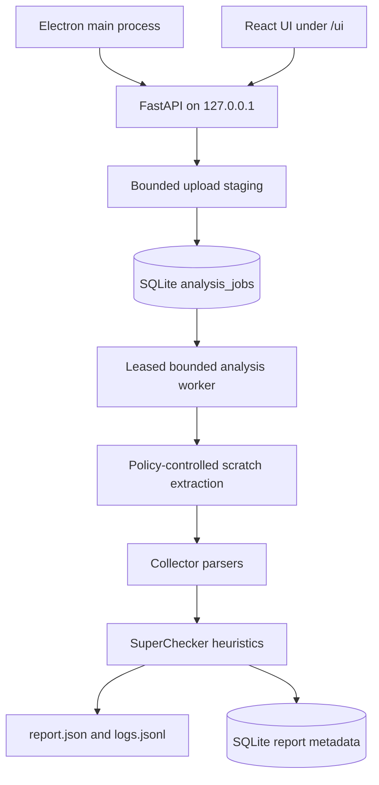
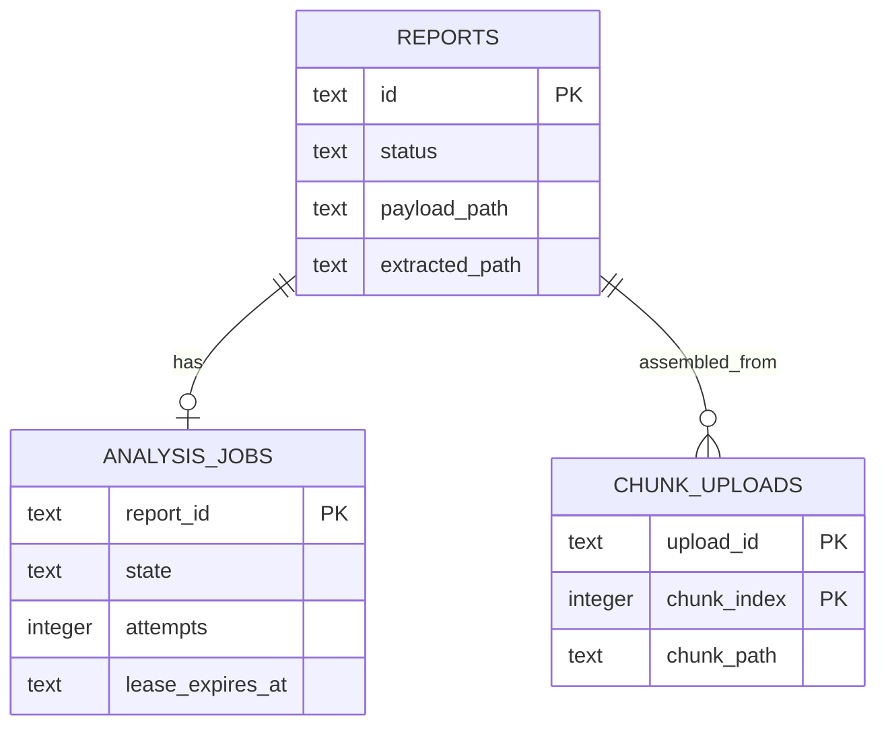

# AGENTS.md

## Canonical workspace
- The canonical local repository for this project is `/Users/shahidster-macmini/S2-report-sniffer` on the SSH host `macmini`.
- For all future project work, treat that Mac mini checkout as the source workspace unless the user explicitly designates a different repository.
- Do not assume another local clone is canonical, and do not synchronize, overwrite, commit, or push from another clone without explicit user authorization.

## Project snapshot

- `S2 Report Sniffer` analyzes offline SingleStore Cluster Reports and turns them into dashboards, findings, recommended actions, and exports.
- Core flow: `backend/server.py` validates uploads, extracts archives, calls `backend/parsers.py`, scores with `backend/superchecker.py`, and persists through `backend/storage.py`.
- Keep `backend/validators.py`, `backend/monitoring.py`, and `backend/storage.py` in sync when changing request or report payloads.

## SingleStore terminology policy

- `docs/TERMINOLOGY.md` is the vocabulary source of truth for user-facing text.
- Verify new product terminology against current `docs.singlestore.com` pages before merging.
- Prefer **SingleStore Cluster Report** over “diagnostic bundle”, “support bundle”, or “report bundle”.
- Prefer **Long-Running Queries** over “Runaway Queries”. Use **Queries Above the Sniffer Elapsed-Time Threshold** for the product-defined 30-second to 5-minute heuristic band rather than presenting it as an official SingleStore threshold.
- Use **tracelog** for `memsql.log` and related files in the tracelogs directory. Use generic **logs** only when a view combines tracelogs with OS, audit, or other sources.
- Use exact SQL object names such as `SHOW PROCESSLIST`, `information_schema.PROCESSLIST`, and `MV_PROCESSLIST` where applicable.
- Preserve stable checker IDs, API fields, database columns, route paths, serialized payload keys, and collector names. Map legacy identifiers such as `runawayQueries` and `runaway_queries` to documentation-aligned display labels at the presentation boundary.
- Mark product-defined thresholds and scoring as **Sniffer heuristics**. Do not present the Cluster Health Score as an official SingleStore health verdict.
- Update tests whenever user-visible terminology changes.

## Architecture to keep in mind



- This is local-first. `desktop/main.js` and `backend/desktop_entry.py` launch a bundled FastAPI backend on `127.0.0.1` and load the React UI from `/ui/`.
- When `frontend/build/` exists, `GET /` redirects to `/ui/` so UI and API share one origin.
- Local persistence is SQLite/file-based through `S2RS_DATA_DIR` (default `~/.s2-report-sniffer`; use `S2RS_DATA_DIR=./local_data` in development). Do not assume MongoDB or cloud storage.
- No Cluster Report data leaves the machine by default. There is no product telemetry, crash reporting, or backend egress for root-cause analysis. Optional Hostinger behavior remains gated by `S2RS_ENABLE_CLOUD_EXTENSIONS`.
- **Analyze in Glean:** the Issues toolbar builds a local Markdown incident packet (`GET /api/reports/{id}/export/glean`) with findings and suspected tracelog lines, then downloads it or opens the Glean macOS app. The user attaches the file in Glean Chat; nothing is sent until they do. See `docs/ai-rca-design.md`.

## Frontend/backend integration

- React Router lives in `frontend/src/App.jsx` with two top-level routes: `/` (`ReportList`) and `/report/:reportId/*` (`ReportDashboard`).
- `frontend/src/lib/api.js` uses same-origin `/api` under `/ui`; otherwise it uses `import.meta.env.VITE_BACKEND_URL`.
- `frontend/vite.config.js` proxies `/api` from the Vite development server on port 3000 to `http://localhost:8000`.
- Export API helpers from `frontend/src/lib/api.js`; do not create inline API calls in components.
- Key exports include `uploadReport`, `listReports`, `getReportStatus`, `getReportOverview`, `getReportNodes`, `getReportStorage`, `getReportQueries`, `getReportLogs`, `getReportRecommendations`, `getReportConfig`, `deleteReport`, and `getGleanPacket`.

## Dashboard design source of truth

- Use `DESIGN.md` as the primary interface design reference.
- Keep visual enhancements meaningful, polished, and consistent with the design system.
- Charts live in `frontend/src/components/charts/`; the dashboard container is `frontend/src/components/ChartsDashboard.jsx`.
- Feature components live in `frontend/src/components/`. Notable components include `ClusterOverview.jsx`, `NodeDownDetails.jsx`, and `ClusterStatePanel.jsx`.
- shadcn/ui primitives live in `frontend/src/components/ui/`; do not modify them manually.

## Developer workflow

Backend development:

```bash
cd backend
python -m venv .venv && source .venv/bin/activate
pip install -r requirements.txt -r requirements-dev.txt
S2RS_DATA_DIR=./local_data uvicorn server:app --host 127.0.0.1 --port 8000 --reload
```

Frontend development:

```bash
cd frontend
npm install
npm run dev
```

Frontend gate:

```bash
cd frontend
npm test
npm run build
```

`dev-setup.sh` starts the backend and launches the frontend for integrated development.

## Tests to run when behavior changes

- Backend parsing/API changes: `cd backend && python -m pytest test_parsers.py test_api_smoke.py test_superchecker.py -v`
- Single backend file: `cd backend && .venv/bin/python -m pytest test_log_search.py -v`
- Full backend suite: `cd backend && .venv/bin/python -m pytest`
- Frontend changes: `cd frontend && npm test && npm run build`
- Tracelog search: `cd backend && .venv/bin/python -m pytest test_log_search.py test_log_search_raw.py -v`
- There is no repository-wide lint script. Run `flake8 <file>` and `black --check <file>` directly when needed.
- Upload validation must continue to accept `.zip`, `.tar.gz`, `.tgz`, `.tar`, and `.gz` with multipart field `file`; the legacy `report` field remains accepted.

## Conventions

- Report IDs are UUIDs. Use `validators.validate_report_id()` in every endpoint before touching the filesystem or database.
- The upload cap is 10 GB; the rate limit is 10 uploads per minute per IP address.
- Use Python 3.11 native type syntax: `list[str]` and `str | None`; do not import `List` or `Optional` from `typing`.
- All external input must pass through `validators.py` and the `ValidationResult.success(sanitized=...)` / `.failure([errors])` pattern.
- Avoid broad `try/except/pass`. Use lossy parsing only where graceful degradation is intentional.
- Always use parameterized SQL statements.
- Enable the repository hook after cloning with `git config core.hooksPath .githooks`.

## Storage schema changes



Analysis work is durable. API routes enqueue `analysis_jobs`; `services/analysis_jobs.py` claims jobs transactionally and renews leases. Do not reintroduce fire-and-forget parsing tasks.

## Parser module map

| Responsibility | Current module |
| --- | --- |
| Archive policy and admission | `backend/archive_security.py` |
| Archive extraction and collector parsing | `backend/parsers.py` |
| Durable analysis orchestration | `backend/services/analysis_jobs.py` |
| Finding/scoring rules | `backend/superchecker.py` |
| Finding grounding | `backend/grounding.py` |
| Optional local inference | `backend/local_ai/` |

When adding a column to the `reports` table in `backend/storage.py`, update all three locations:

1. `_init_db()` — additive `ALTER TABLE` migration.
2. `update_report_fields()` — add the column to the write allowlist.
3. `get_report_fields()` — add the column to the read allowlist.

The payload JSON (`report.json`) is separate from these SQL columns. Overview, nodes, and related analysis payloads use `write_report_payload()`.

## Tracelog search

`/api/reports/{id}/logs/search` has two response modes:

- **`raw`** — preferred when an extracted Cluster Report root is retained. `search_all_trace_logs()` wraps `search_trace_logs_raw()` across each node’s `memsqlTracelogs/`, including compressed and uncompressed `*_memsql.log` files, with context and line numbers.
- **`parsed`** — fallback over `logs.jsonl` through `LocalReportStore.search_report_logs()`. It has no context windows and matches against timestamp, message, and hostname.

The extracted root is stored under `<S2RS_DATA_DIR>/reports/{id}/extracted/` and removed with the report. Retention is gated by `S2RS_MAX_EXTRACTED_KEEP_GB` (default 2 GB; `0` disables retention). Directory imports retain the import path in place.

## Adding or changing findings

- Add parser signals first, then score them in `backend/superchecker.py`; do not add heavy file scans to API endpoints.
- Keep checker IDs stable because tests and saved reports depend on them.
- Ground every checker ID in `backend/grounding.py` with a basis (`documented`, `toolbox-default`, `heuristic`, or `observed`), a verified source, and a concise criterion.
- Never fabricate documentation URLs. Leave `source=""` when a source has not been verified.
- Label operational rules of thumb as **heuristic**.
- Preferred signal families from Cluster Reports:
  - Tracelogs: `*memsql.log` patterns such as `ETIMEDOUT`, `fsync is behind`, retry stalls, synchronous-to-asynchronous transitions, and backup events.
  - Host resources: `sysctl_stdout`, `free_stdout`, `ulimit_stdout`, `df_stdout`, `top_stdout`, dmesg, and memsqld process limits.
  - Information-schema snapshots: variables, extended status, cluster status, distributed databases, processlist, and backup history.
- Store compact normalized values rather than raw shell output.
- Keep payload changes synchronized across validators, monitoring, storage, backend responses, and frontend rendering.

## Implemented analysis areas

- Tracelog coverage per node.
- Backup reliability and duration.
- Network and storage pressure indicators.
- Memory pressure and OOM indicators.
- Cluster topology and partition distribution.
- Active query and open-transaction snapshots from processlist data.
- Database disk usage.
- Node health distribution.
- Tracelog severity distribution.
- Node state transitions and rebalance events from `MV_EVENTS`.
- Long-Running Queries, queries above Sniffer thresholds, repeated query patterns, and highest-memory queries. Stable compatibility identifiers include `runawayQueries`, `slowQueries`, `runaway_queries`, and `slow_queries`.
- Replication lag and synchronous-to-asynchronous transitions.
- Per-node memory utilization.
- Long-running transactions and lock contention.
- Interactive cluster topology, triage views, desktop packaging, and local Glean handoff.

## Good reference files

- `docs/TERMINOLOGY.md` — SingleStore vocabulary and compatibility rules.
- `CLAUDE.md` — comprehensive architecture and development reference.
- `DESIGN.md` — interface design system.
- `README.md`, `USER_MANUAL.md`, `DEPLOYMENT.md`, `PACKAGING.md`, `INTEGRATION.md`, and `AIRGAP_TEST_PROTOCOL.md`.
- Root-level one-off `*_REPORT.md` and `*_CHECKLIST.md` files may be historical snapshots; verify them before relying on their conclusions.

## Learned user preferences and workspace facts

- Create a feature branch before committing from `main`; do not commit directly to `main`.
- Never commit customer investigation tracelogs or large sample Cluster Report archives.
- Never commit `.build/` PyInstaller artifacts.
- Keep commits scoped to one logical change.
- Do not edit attached implementation-plan files.
- Never invent client-side health scores, grades, or measured-looking zeroes when backend data is absent. Show `unknown` or `—`.
- Log-search terms must be actual tracelog messages or patterns, not checker IDs.
- `health_score` and `health_grade` are backend-owned.
- `missingClusterDb` checks the `cluster` system database.
- Python virtual environments may exist at repository root or under `backend/`.
- `S2RS_DATA_DIR` is working-directory relative.
- TypeScript 6 path aliases use `"@/*": ["./src/*"]` without deprecated `baseUrl`.
- Table-like payload fields may arrive as `{ rows: [...] }`; normalize them with frontend `asRowList()` and backend `_as_row_list()`.
## Learned Workspace Facts
- Analyze in Glean builds a whole-report Markdown packet via `build_glean_packet()` / `GET /api/reports/{id}/export/glean`; desktop handoff is `window.s2rsDesktop.gleanHandoff` (preload IPC). Packet includes per-cluster `log_context`, `detected_log_patterns`, and `node_events`; egress only when user attaches in Glean. `gleanHandoff.js` handles Electron IPC + browser fallback; `gleanConstants.js` URL helpers (`gleanWebAppOrigin()` strips `-be`; MCP Settings opens `app.glean.com`). Distinct from Copy Summary (short human brief) and Export JSON (machine dump).
- Incident clusters gain `log_context` on `/api/reports/{id}/triage` and `/overview` reads via `resolve_incident_clusters()` when missing — no re-upload required. One sdb-report is one cluster; the Recommendations “Incident Clusters” UI section was removed as misleading.
- Log search keywords must be tracelog message/pattern terms, not superchecker checker IDs (e.g. `runawayQueries` never appears in `memsql.log`).
- Table-skew analytics excludes zero-row hosts and cannot detect partitionless idle leaves — use `clusterLayoutImbalance` for layout skew.
- `get_report_triage` bucket assignment is mutually exclusive: priority 1 → `act_now`, elif `quick_win` → `quick_wins`, elif priority 2 → `act_soon`, else `backlog` (priority 1 wins over `quick_win`).
- `health_score`/`health_grade` are backend-owned (numeric + letter); legacy stored string scores need normalization. Missing memory/replication/processlist signals should be null/`unknown`, not `0`/`healthy`.
- Python virtualenv may exist at repo root `.venv` and/or `backend/.venv`; use whichever is present when running pytest.
- `S2RS_DATA_DIR` is cwd-relative — `S2RS_DATA_DIR=./local_data` from `backend/` writes to `backend/local_data`, not repo-root `.local_data`.
- Stale zip-upload reports lack `extended_diagnostics` until directory import or `POST /api/reports/{id}/rehydrate-diagnostics`; MV_EVENTS/CPU/network panels need file-backed bundles with sysinfo. `missingClusterDb` checks the `cluster` system database (not `cluster_management`).
- TypeScript 6 deprecates `baseUrl` in `frontend/jsconfig.json`/`tsconfig.json` — remove `baseUrl` and use explicit `"@/*": ["./src/*"]` path aliases.
- Desktop DMG: `PYTHON_BIN=python3.11 bash scripts/build-desktop.sh` → `dist/installers/S2 Report Sniffer-1.0.0-arm64.dmg`; prefer Python 3.11 over 3.14 for PyInstaller. `backend/s2rs-backend.spec` `_SKIP_DIRS` must include `local_data`. Packaging must ad-hoc reseal the `.app` with sealed resources and pass `codesign --verify --deep --strict` or Gatekeeper reports “damaged”; quarantine clear: `scripts/macos-clear-quarantine.sh` / `xattr -cr`. Electron Copy/Paste needs an Edit menu plus `window.s2rsDesktop.clipboardWriteText` (prefer over `navigator.clipboard` in the sandbox).
- Chart/overview table fields (`backup_history`, `database_disk_usage`, `cluster_overview.nodes_detail`) may arrive as `{ rows: [...] }` wrappers; normalize with frontend `asRowList()` and backend `_as_row_list()` before `.map()`.

## Skill routing
gstack skills are available on this machine (invoke by name, e.g. `/investigate`, `/qa`, `/review`, `/ship`). The full trigger→skill table is enumerated in this session's `available_skills`; match on the trigger description there rather than maintaining a copy here.

## Log search (dual-mode)
`/api/reports/{id}/logs/search` has two modes, reported in the response as `search_mode`:
- **`raw`** — preferred when an extracted report root is persisted on disk. Calls `search_all_trace_logs` (wraps `search_trace_logs_raw`) across every node's `memsqlTracelogs/`, scans compressed + uncompressed `*_memsql.log`, and returns `context_before`/`context_after`/`line`/`line_number` per match.
- **`parsed`** — fallback over `logs.jsonl` via `LocalReportStore.search_report_logs`. No context windows; matches against `timestamp + message + hostname`.
The extracted root lives at `<S2RS_DATA_DIR>/reports/{id}/extracted/` and is auto-cleaned by `delete_report`'s tree wipe. Persistence is gated by `S2RS_MAX_EXTRACTED_KEEP_GB` (default **2 GB**, env-tunable; `0` disables). Over-cap reports still parse but fall back to parsed mode. Directory imports persist the import path in place (no copy). When adding log-search tests, use `test_log_search.py` (parsed mode) and `test_log_search_raw.py` (raw mode).

## Storage schema changes (3-place allowlist gotcha)
When adding a new column to the `reports` table in `backend/storage.py`, you must touch **all three** places or the column silently won't read/write:
1. `_init_db()` — add `ALTER TABLE reports ADD COLUMN <name> TYPE` (additive migration pattern).
2. `update_report_fields()` — add the column to the `allowed` set, else writes are silently dropped.
3. `get_report_fields()` — add the column to the `allowed` list, else `fields=["<name>"]` selects only `id` and returns `None` for your column.
The payload JSON (`report.json`) is separate from these SQL columns — overview/nodes/etc. go through `write_report_payload`, not `update_report_fields`.
