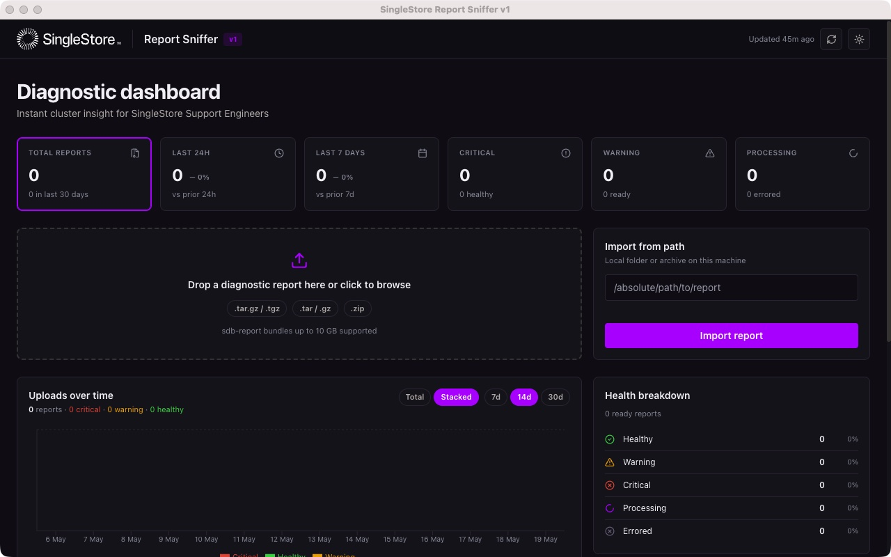

<h1 align="center">
  
</h1>

<p align="center">
  
  
  
  
  
</p>

<p align="center">
  <strong>Offline Diagnostic Intelligence for SingleStore Clusters</strong>
</p>

---

## Why I Built This

When we troubleshoot self-managed database environments, we are entirely reliant on massive cluster reports. We pull gigabytes of `memsql.log` files, OS metrics, and hardware telemetry across dozens of nodes. Manual `grep`-based triage is painfully slow, and it is too easy to miss critical warnings. I built **S2 Report Sniffer** as a side project to automate the grunt work so we can focus on actual problem-solving. Here’s how it helps us:

| Capability | What It Does For Us |
|---|---|
| **Streaming Ingestion** | Parses massive 10GB+ archives locally without crashing your machine with OOM errors. |
| **Correlation** | Automatically stitches together `memsql.log`, `dmesg`, and OS metrics to build a timeline. |
| **SuperChecker** | Scores findings by actual operational risk so we know what to look at first. |
| **Analyze in Glean** | Builds a local Markdown incident packet (findings + suspected logs) you can paste into Glean Chat — no auto-egress. |

---

## Architecture

Here’s how I wired it up to keep everything fast and local:

```
┌─────────────────────────────────────────────────────────────┐
│                    S2 Report Sniffer                        │
├─────────────────────────────────────────────────────────────┤
│  ┌──────────────┐   ┌──────────────┐   ┌──────────────┐     │
│  │   Electron   │◀──│   FastAPI    │◀──│   Parsers    │     │
│  │  Desktop UI  │   │   Backend    │   │   Engine     │     │
│  └──────────────┘   └──────────────┘   └──────────────┘     │
│         │                  │                  │             │
│         ▼                  ▼                  ▼             │
│  ┌──────────────┐   ┌──────────────┐   ┌──────────────┐     │
│  │   SQLite     │   │  Diagnostic  │   │ SuperChecker │     │
│  │ (Local DB)   │   │   Bundles    │   │   Scoring    │     │
│  └──────────────┘   └──────────────┘   └──────────────┘     │
└─────────────────────────────────────────────────────────────┘
```

---

## Key Features

### Diagnostic Capabilities

- **Log Timeframe Detection** — Shows exactly what telemetry coverage we actually have per node.
- **Backup Reliability** — Catches silent failures and duration drift before the customer notices.
- **Hardware Pressure** — Highlights IOPS stalls, network drops, and memory pressure.
- **Topology Sanity** — Validates partition distribution so we aren’t chasing ghosts.
- **Process Health** — Maps out active queries and sleeping transactions.
- **Query Tracer** — Reconstructs query lifecycles from tracelogs for slow / runaway investigations.
- **Incident Triage** — Groups related findings into act-now / act-soon / quick-win / backlog buckets.
- **Dual-Mode Log Search** — Prefer raw `*_memsql.log` scans with context windows; fall back to parsed `logs.jsonl`.

### Engineering Highlights

- **Local-First** — Zero customer data leaves your laptop. Full stop.
- **Bounded Memory** — Uses Python generators so it maintains a fixed memory footprint.
- **Risk Scoring** — The “Fix-First” Recommendations view prioritizes the fires (risk score 0–100).
- **Analyze in Glean** — Local incident-packet handoff for Glean Chat (optional cloud MCP remains off by default).
- **Desktop Packaging** — Unsigned macOS DMG via `scripts/build-desktop.sh` or the `desktop-macos-dmg` GitHub Actions artifact.

---

## Getting Started

If you want to run it from source or contribute (pull requests welcome!), here’s the setup.

### Prerequisites

- Python **3.11+**
- Node.js **20+**

### Backend Setup

```bash
cd backend
python -m venv .venv
source .venv/bin/activate
pip install -r requirements.txt
S2RS_DATA_DIR=./local_data uvicorn server:app --host 127.0.0.1 --port 8000 --reload
```

### Frontend Setup

```bash
cd frontend
npm install
npm run dev
```

Vite serves the UI on port **3000** and proxies `/api` to the backend on **8000**.

### Desktop Build (macOS DMG)

Local Mac build:

```bash
PYTHON_BIN="$(command -v python3.11 || command -v python3)" bash scripts/build-desktop.sh
# → dist/installers/*.dmg  and  desktop/dist/*.dmg
```

Or download the CI artifact **`S2ReportSniffer-macos-unsigned-dmg`** from Actions → **desktop-macos-dmg** (built on `macos-latest`). Unsigned builds may need right-click → Open the first time, or:

```bash
xattr -dr com.apple.quarantine "/Applications/S2 Report Sniffer.app"
```

---

## How to Use

### Step 1 — Launch the App

Open **S2 Report Sniffer** from your Applications folder. The Electron app bootstraps the local backend automatically:

```
Applications/
└── S2 Report Sniffer.app        ← macOS desktop app (recommended)
```

**Dev tip:** You can also hit the web UI at `http://localhost:3000` while developing, or `http://localhost:8000/ui/` when the production frontend build is present.

### Step 2 — Upload a Cluster Report

The home screen acts as your Diagnostic Dashboard.



1. Drag and drop a SingleStore diagnostic archive onto the upload zone, or click to browse.
2. **Import from path** — enter a local folder or archive path if the file is massive and already on disk.
3. Click **Import report** to start parsing.

Accepted formats: `.zip`, `.tar.gz`, `.tgz`, `.tar`, `.gz` — up to **10 GB**.

> **Note on failures:** If it throws an “invalid format” error, double-check that the customer actually used `sdb-report collect`. Raw log dumps zipped up by hand won’t work.

### Step 3 — Wait for Analysis

Processing time depends on the bundle size. A standard ~1 GB bundle typically takes about 30–90 seconds.

| Status | Meaning |
|---|---|
| `uploading` | File is transferring to the local workspace. |
| `processing` | Extracting, parsing logs, and running the SuperChecker engine. |
| `ready` | Analysis complete — jump in. |
| `errored` | Something broke. Check the troubleshooting section below. |

### Step 4 — Explore the Report Dashboard

Click any **ready** report. You’ll see these main views:

#### Cluster Overview

Your 10,000-foot view — node counts, partition health, backup status, topology, recent dmesg panics, and pressure signals.

#### Recommendations / Triage

This is the money screen. SuperChecker ranks findings by risk score. Click a row for severity, description, evidence, and how to fix it. Incident clusters and triage buckets (`act_now`, `act_soon`, `quick_wins`, `backlog`) help prioritize.

| Column | What it shows |
|---|---|
| Severity | `critical` / `warning` / `info` |
| Checker ID | The specific check that flagged this. |
| Title | A plain-English summary of the issue. |
| Risk Score | **0–100** composite score indicating impact. |
| Nodes | Which specific hosts are screaming. |

#### Node Health & Capacity

Per-node memory, disk utilization, partition distribution, and OS metrics (swap, cgroup, THP).

#### Config Health

License validity, engine variables, auth settings, SSL/TLS config, and standard security postures.

#### Diagnostics & Query Tracer

Extended diagnostics panels when the bundle has the signals, plus Query Tracer for reconstructing query lifecycles from tracelogs.

### Step 5 — Understand the Health Score

SuperChecker grades the cluster from **0–100** so you can quickly gauge how bad things are:

| Grade | Score | Meaning |
|---|---|---|
| **A** | 90–100 | Healthy — no immediate action required. |
| **B** | 80–89 | Minor issues — keep an eye on it. |
| **C** | 70–79 | Moderate risk — start reviewing recommendations. |
| **D** | 60–69 | Elevated risk — actively investigate. |
| **F** | 0–59 | Critical — drop everything and fix. |

### Keyboard Shortcuts

| Shortcut | Action |
|---|---|
| `⌘R` | Refresh reports list. |
| `⌘O` | Open file browser to select a new archive. |
| `⌘⌥I` | Open DevTools (development builds only). |

---

## Troubleshooting

Things break. Here’s how to fix the app when it acts up.

### App Won’t Open / Window is Blank

**Symptom:** The app launches but shows a white screen.

**Solution:**
1. Quit the app (`⌘Q`).
2. Open Activity Monitor and kill any orphaned S2 Report Sniffer processes.
3. Restart from Applications.
4. If it persists, check if port 8000 is blocked: `lsof -i :8000`

### Upload Fails with “Unable to Extract”

**Symptom:** Report immediately hits `errored` status.

**Likely causes:** The file isn’t a valid bundle, the download corrupted, or it’s from a legacy `sdb-report` version.

**Solution:**
1. Verify file integrity: `file customer-report.zip`
2. Re-download from the support portal.
3. Bundles from SingleStore versions &lt; 7.5 might be missing critical telemetry signals.

### Report Stays in “Processing” State

**Symptom:** It’s been spinning for over 5 minutes.

**Solution:** Check the terminal / backend logs. If you see `DecompressionBombError` or `MemoryError`, ask the customer to split collection with an `sdb-report collect` node filter.

### “No Data Available”

**Symptom:** Node Health or Config Health screens are empty on a `ready` report.

**Solution:** The customer probably ran collection without OS metrics. Ask for a fresh bundle:

```bash
sdb-report collect --validate-env --include-infra
```

### Backend Errors on Startup

**Symptom:** “Backend unavailable” error in the UI.

**Solution:** Boot the backend manually to see the traceback:

```bash
cd backend
source .venv/bin/activate
S2RS_DATA_DIR=./local_data uvicorn server:app --host 127.0.0.1 --port 8000 --reload
```

Watch for:
- `ModuleNotFoundError` → `pip install -r requirements.txt`
- `PermissionError` on the data dir → fix permissions on `S2RS_DATA_DIR`
- `Database is locked` → close other instances and retry

### Dark Mode Not Applying

**Symptom:** Badges or borders stay light when toggled.

**Solution:** Known CSS debt — some hardcoded hex values still need CSS variables. Cosmetic only; tracked in the backlog.

### Performance Issues with Huge Bundles

**Symptom:** UI locks up on 2GB+ bundles.

**Solution:** Close heavy apps. For very large bundles, bypass the UI and run the parser from the CLI:

```bash
cd backend && source .venv/bin/activate
python -c "
from parsers import parse_report_archive_streaming
for node in parse_report_archive_streaming('/path/to/bundle.tar.gz'):
    print(node.get('hostname'), node.get('version'))
"
```

---

## Supported Formats

| Format | Extension |
|---|---|
| Tarball | `.tar.gz`, `.tgz` |
| ZIP | `.zip` |
| Single File | `.tar`, `.gz` |

**Max Size:** 10 GB

---

## Security Posture

We deal with highly sensitive database telemetry. I architected this strictly for offline operation:

- No telemetry leaves your local machine.
- No remote crash reporting or analytics are embedded.
- All extracted data stays under `S2RS_DATA_DIR` (default `~/.s2-report-sniffer`) as local SQLite + files.

---

<p align="center">
  
</p>

<div align="center">
  Built for Database Reliability Engineering &amp; Advanced Support Operations
</div>
