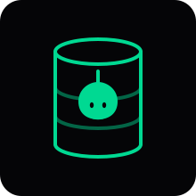

<div align="center">



# S2 Report Sniffer

### Turn large SingleStore Cluster Reports into an actionable triage dashboard—locally, privately, and fast.

**A local-first analyzer for Cluster Reports generated by `sdb-report`, built for support engineers who need evidence—not more grep.**

<p>
  <a href="../../releases"></a>
  <a href="LICENSE"></a>
  
  
</p>

[Quick start](#quick-start) · [What it does](#what-it-does) · [Architecture](#architecture) · [Security](#security-and-privacy) · [Contributing](#contributing)

</div>

---

## The problem

A SingleStore Cluster Report can contain gigabytes of node tracelogs, kernel output, system information, configuration, and information-schema snapshots. Diagnosing it manually often means hours of searching files, correlating timestamps, comparing nodes, and separating a primary failure from downstream symptoms.

S2 Report Sniffer turns the Cluster Report into a structured workspace:

```text
SingleStore Cluster Report
        ↓
validate → extract → parse → correlate → score
        ↓
cluster health summary + ranked findings + evidence + recommended actions
```

Everything runs on the local machine. Customer data is not uploaded to a hosted service.

## What it does

| Capability | Result |
|---|---|
| **Streaming ingestion** | Parses Cluster Report archives in `.zip`, `.tar.gz`, `.tgz`, `.tar`, and `.gz` formats up to 10 GB with bounded memory. |
| **Cross-node correlation** | Combines tracelogs, host signals, cluster topology, configuration, and information-schema data into one investigation view. |
| **Risk-ranked findings** | Prioritizes findings as Immediate, Quick Win, Soon, or Backlog with evidence and recommended actions. |
| **Cluster health scoring** | Produces a 0–100 health score and grade for rapid triage—not as a substitute for engineering judgment. |
| **Tracelog search** | Searches retained raw tracelogs with context windows, with a parsed-log fallback when extracted files are unavailable. |
| **Cluster Report comparison** | Compares two reports to highlight new, resolved, worsened, configuration, and metric changes. |
| **Optional anonymization** | Masks hostnames, IP addresses, database names, and credentials before persistent storage. |
| **Glean handoff** | Generates a local Markdown incident packet that the user may manually attach to Glean Chat. |
| **Desktop packaging** | Ships as an Electron desktop application with a bundled FastAPI backend. |

## Product principles

> **Local by default. Explainable by design. Useful under incident pressure.**

- No product telemetry or crash reporting by default.
- No automatic upload of Cluster Report contents.
- Findings include supporting evidence and affected nodes.
- Large Cluster Reports are processed with explicit file, row, and decompression limits.
- The interface is optimized for triage first and deep investigation second.

## Quick start

### Desktop application

Download the current build from the [Releases](../../releases) page, install it, and open a SingleStore Cluster Report from the home screen.

Build the macOS Apple Silicon package from source:

```bash
PYTHON_BIN=python3.11 bash scripts/build-desktop.sh
```

The installer is written to:

```text
dist/installers/S2 Report Sniffer-1.0.0-arm64.dmg
```

### Run from source

Requirements:

- Python 3.11+
- Node.js 20+

Start the backend:

```bash
cd backend
python -m venv .venv
source .venv/bin/activate
pip install -r requirements.txt -r requirements-dev.txt
S2RS_DATA_DIR=./local_data uvicorn server:app --host 127.0.0.1 --port 8000 --reload
```

Start the frontend in another terminal:

```bash
cd frontend
npm install
npm run dev
```

Open `http://localhost:3000`. API documentation is available at `http://127.0.0.1:8000/api/docs`.

You can also run `./dev-setup.sh` from the repository root.

### Integrated UI and API

```bash
cd frontend && npm run build
cd ../backend
S2RS_DATA_DIR=./local_data .venv/bin/uvicorn server:app --host 127.0.0.1 --port 8000
```

Open `http://127.0.0.1:8000/ui/`.

## Typical workflow

1. **Generate** a Cluster Report with `sdb-report collect`, or use `sdb-report collect-local` for one host.
2. **Upload or import** the generated Cluster Report archive.
3. **Keep anonymization enabled** unless identifiable values are required for the investigation.
4. **Wait for processing** to move from `uploading` to `processing` to `ready`.
5. **Review the cluster health score** and the highest-priority findings.
6. **Inspect evidence** across Overview, Diagnostics, Nodes, Storage, Queries, Logs, Config, and Issues.
7. **Review Long-Running Queries** and other query activity using captured processlist data.
8. **Compare Cluster Reports** when validating whether remediation improved the cluster.
9. **Create a local Glean packet** only when an external handoff is appropriate.

### Health grades

| Grade | Score | Triage meaning |
|:---:|:---:|---|
| **A** | 90–100 | Healthy |
| **B** | 80–89 | Minor issues |
| **C** | 70–79 | Review findings |
| **D** | 60–69 | Investigate promptly |
| **F** | 0–59 | Prioritize Immediate findings |

The cluster health score provides context. Always validate the underlying evidence and recommended actions.

## Architecture

```text
┌──────────────────────────────────────────────────────────────┐
│ Electron desktop shell or browser                            │
└──────────────────────────────┬───────────────────────────────┘
                               │ /api
┌──────────────────────────────▼───────────────────────────────┐
│ FastAPI backend                                               │
│ upload → validation → safe extraction → parsing → correlation│
│                       → scoring → SQLite/filesystem storage   │
└──────────────────────────────┬───────────────────────────────┘
                               │
┌──────────────────────────────▼───────────────────────────────┐
│ React + Vite + shadcn/ui + Recharts                          │
│ /             Cluster Report workspace                       │
│ /report/:id   Cluster Report dashboard                       │
└──────────────────────────────────────────────────────────────┘
```

All application data is stored under `S2RS_DATA_DIR`—by default `~/.s2-report-sniffer`, or `./local_data` during development.

### Technology stack

| Layer | Technology |
|---|---|
| Backend API | FastAPI and uvicorn |
| Parsing | Python generators and bounded streaming readers |
| Frontend | React 19 and Vite |
| UI | shadcn/ui, Radix UI, and Tailwind CSS |
| Charts | Recharts |
| Desktop | Electron and electron-builder |
| Persistence | SQLite and local filesystem |

## Security and privacy

- Local-only processing by default.
- Path-bounded extraction to prevent archive traversal.
- Decompressed-size limits and upload rate limits.
- A hard 10 GB Cluster Report archive limit.
- Optional pre-storage anonymization.
- Parameterized SQL queries.
- No automatic Glean upload—the generated incident packet stays local.
- Git hooks that block common secret files and credential patterns.

Read [`SECURITY_REVIEW.md`](SECURITY_REVIEW.md), [`AIRGAP_TEST_PROTOCOL.md`](AIRGAP_TEST_PROTOCOL.md), and [`LOCAL_FIRST_ARCHITECTURE.md`](LOCAL_FIRST_ARCHITECTURE.md) for the detailed controls and threat model.

## Testing

Backend:

```bash
cd backend
.venv/bin/python -m pytest -v
```

Frontend:

```bash
cd frontend
npm test
npm run build
```

Focused tracelog-search tests:

```bash
cd backend
.venv/bin/python -m pytest test_log_search.py test_log_search_raw.py -v
```

Enable repository hooks after cloning:

```bash
git config core.hooksPath .githooks
```

## Troubleshooting

| Symptom | Recommended action |
|---|---|
| Blank Electron window | Quit the app, terminate orphaned processes, and confirm port `8000` is free. |
| Invalid archive or extraction error | Confirm the input was generated with `sdb-report collect` and verify the file type. |
| Cluster Report remains in `processing` | Check backend logs for memory, decompression, or malformed-input errors. |
| Empty diagnostics panels | Generate a complete multi-node Cluster Report with the required collectors. |
| Backend unavailable | Activate the backend virtual environment and start uvicorn manually. |

## Documentation

| Document | Purpose |
|---|---|
| [`USER_MANUAL.md`](USER_MANUAL.md) | End-user walkthrough |
| [`DESIGN.md`](DESIGN.md) | Interface and visual-system guidance |
| [`AGENTS.md`](AGENTS.md) | Contributor architecture and conventions |
| [`PACKAGING.md`](PACKAGING.md) | Electron and PyInstaller packaging |
| [`INTEGRATION.md`](INTEGRATION.md) | Integration and handoff design |
| [`DEPLOYMENT.md`](DEPLOYMENT.md) | Deployment notes |
| [`PREPROD_TEST_REPORT.md`](PREPROD_TEST_REPORT.md) | Pre-release validation |
| [`PRODUCT_ROADMAP.md`](PRODUCT_ROADMAP.md) | Planned work |

## Contributing

Contributions are welcome. Start with [`AGENTS.md`](AGENTS.md), which documents the architecture, development conventions, and storage-schema allowlists.

```bash
git clone https://github.com/shahidstermain/S2-report-sniffer.git
cd S2-report-sniffer
git config core.hooksPath .githooks
./dev-setup.sh
```

Before opening a pull request, run the backend test suite and the frontend test/build commands shown above.

## License

See [`LICENSE`](LICENSE).

---

<div align="center">

Built for fast, evidence-driven SingleStore Cluster Report triage.

</div>
