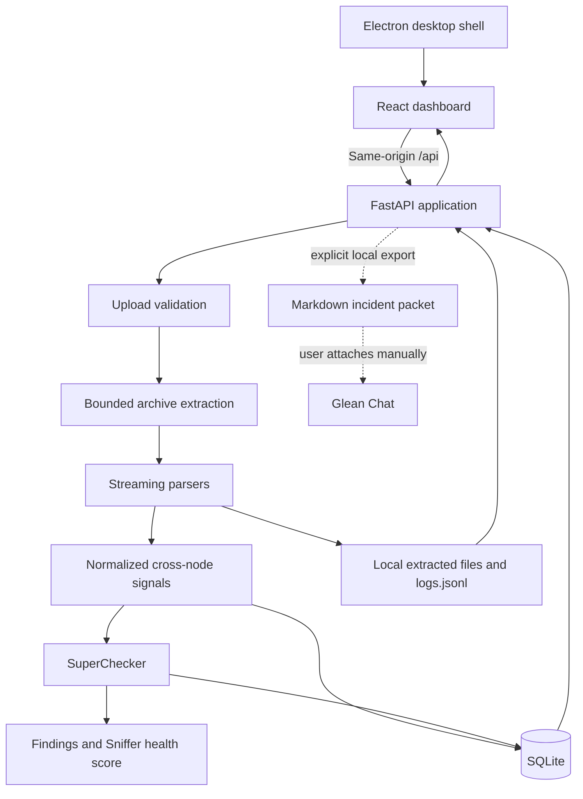

# S2 Report Sniffer

## Local-first diagnostics for large SingleStore Cluster Reports

Stream, correlate, analyze, and triage SingleStore Cluster Report data without customer data leaving your machine.

> **Current release:** See the canonical GitHub release page for the current version and supported packages.
> **Download:** [Latest S2 Report Sniffer release](https://github.com/shahidstermain/S2-report-sniffer/releases/latest)
> **Source:** [S2 Report Sniffer on GitHub](https://github.com/shahidstermain/S2-report-sniffer)
>
> This long-form overview contains historical v1.1.0 notes for compatibility context. Current user instructions live in [`README.md`](../README.md), [`USER_MANUAL.md`](../USER_MANUAL.md), and [`CHANGELOG.md`](../CHANGELOG.md).

---

## What S2 Report Sniffer Does

S2 Report Sniffer is a local desktop application for investigating SingleStore Cluster Reports. It processes archives as large as 10 GB, correlates signals across nodes, and turns raw diagnostic data into searchable evidence, dashboards, and risk-ranked findings.

The application is designed for incident response and support engineering workflows where customer data must remain local.

### Core capabilities

| Capability | What it provides |
|---|---|
| **Bounded ingestion** | Processes large `.zip`, `.tar.gz`, `.tgz`, `.tar`, and `.gz` inputs with configurable file, row, memory, and decompression limits. |
| **Cross-node correlation** | Connects tracelogs, kernel output, host-resource signals, topology, configuration, and information-schema snapshots. |
| **SuperChecker analysis** | Produces grounded, risk-ranked findings with evidence and remediation guidance. |
| **Tracelog search** | Searches raw or persisted tracelogs by text, regular expression, node, timestamp, and severity. |
| **Storage inventory** | Identifies columnstore and rowstore tables from documented SingleStore metadata. |
| **Disk Intelligence** | Breaks down table-attributed bytes and non-table disk overhead, with automatic hydration for compatible saved v1.1.0 reports. |
| **Local incident handoff** | Creates Markdown incident packets for optional manual attachment in Glean Chat. |
| **Optional local AI** | Can summarize findings and draft incident reports using a local model. It is disabled by default. |

---

## Why I Built It

Troubleshooting self-managed SingleStore environments often means investigating gigabytes of tracelogs, OS metrics, configuration, hardware telemetry, and information-schema snapshots across many nodes.

Manual command-line investigation is useful, but it becomes slow and error-prone when an incident requires evidence from several nodes and signal families. Important warnings can be buried across thousands of files, and reconstructing a reliable timeline takes time.

I built S2 Report Sniffer as a side project to automate that repetitive work while preserving the investigative judgment of the support engineer. It helps answer four questions quickly:

1. What telemetry is actually present in this SingleStore Cluster Report?
2. Which findings deserve attention first?
3. What evidence supports each finding?
4. Where should the investigation go next?

---

## Privacy and Local-First Design

S2 Report Sniffer is local-first by design.

- SingleStore Cluster Report data is processed on the local machine.
- Parsed data is stored in local SQLite and filesystem storage.
- There is no product telemetry, remote crash reporting, or automatic cloud analysis.
- Optional local AI is disabled by default and does not require a cloud model.
- **Analyze in Glean** creates a local Markdown file; it does not upload that file.
- Data leaves the machine only when a user explicitly shares or attaches an exported artifact.

Local state is stored under `S2RS_DATA_DIR`. The default location is:

```text
~/.s2-report-sniffer
```

For development, use a repository-local directory:

```bash
S2RS_DATA_DIR=./local_data
```

---

## Architecture



### Processing flow

```text
Import SingleStore Cluster Report
    → validate the input
    → extract within security and size limits
    → parse available signal families
    → normalize and correlate cross-node evidence
    → run SuperChecker analysis
    → persist results locally
    → render the React dashboard
```

### Technology

| Layer | Technology |
|---|---|
| Desktop | Electron and electron-builder |
| Frontend | React 19, TypeScript, Vite, Tailwind CSS, Radix UI, Recharts |
| API | Python 3.11+, FastAPI, Uvicorn |
| Analysis | Streaming and bounded Python parsers plus SuperChecker |
| Storage | SQLite and local filesystem |
| Packaging | PyInstaller and Electron Builder |

---

## What Is New in v1.1.0

Version 1.1.0 is a major reliability, security, analysis, and incident-triage update.

| Area | Improvement |
|---|---|
| Ingestion | Bounded and isolated Cluster Report parsing with decompression and dataset limits. |
| Processing lifecycle | Durable analysis jobs and recovery for reports interrupted during processing. |
| Archive security | Stronger traversal, symlink, archive-member, and decompression-bomb protection. |
| SQLite | Improved concurrent-read behavior, WAL configuration, and lock handling. |
| Tracelog investigation | Better filters, context navigation, evidence highlighting, and search behavior. |
| Dashboard | Improved loading states, triage navigation, theme support, and large-dataset rendering. |
| Table storage | New columnstore and rowstore inventory based on documented SingleStore values. |
| Disk Intelligence | Fixed persistence for new analyses and automatic one-time hydration for compatible saved v1.1.0 reports. |
| Local AI | Optional local-only summaries, root-cause hypotheses, and incident-report drafts. |
| Terminology | SingleStore-native terminology applied across the user interface. |
| Packaging | Hardened Electron and PyInstaller builds, updater metadata, checksums, and ARM64 validation. |
| Application identity | The desktop app now uses the black-and-green database/sniffer icon shown in the project README. |

The v1.1.0 package was refreshed in place on July 21, 2026. The refreshed package supersedes the earlier v1.1.0 assets; no incremental release was created.

The latest refresh includes the Disk Intelligence persistence fix. Existing compatible v1.1.0 reports rebuild the missing presentation payload from already saved normalized signals; the original Cluster Report is not rescanned and does not need to be re-imported.

---

## Diagnostic Capabilities

### Telemetry coverage

Shows the available tracelog timeframe per node so findings can be interpreted against the data that was actually collected.

### Backup reliability

Reviews backup history for failures, incomplete operations, and duration changes. Findings depend on the backup evidence available in the Cluster Report.

### Storage pressure

Surfaces evidence such as `fsync is behind`, storage latency indicators, disk utilization, and relevant kernel messages.

### Network pressure

Detects patterns such as `ETIMEDOUT`, retry stalls, connectivity failures, and synchronous-to-asynchronous replication transitions.

### Memory pressure

Correlates engine and OS memory information with OOM evidence, Transparent Huge Pages, swappiness, and node-level memory pressure.

### Cluster topology

Reviews node roles, cluster state, partition distribution, node-state transitions, and rebalance events.

### Workload analysis

Surfaces:

- Long-Running Queries
- Queries Above the Sniffer Elapsed-Time Threshold
- Repeated query patterns
- Highest-memory queries
- Active transactions
- Long-running transactions
- Lock contention

Product-defined thresholds are labeled as **Sniffer heuristics** and are not presented as official SingleStore thresholds.

### Replication

Reviews replication lag and synchronous-to-asynchronous transitions using the evidence present in the Cluster Report.

### Configuration

Reviews relevant engine variables, license state, authentication and SSL posture, resource settings, and associated configuration findings.

---

## Columnstore and Rowstore Inventory

The Storage dashboard includes a table-level inventory derived from `information_schema.TABLES` data in the SingleStore Cluster Report.

Classification uses the documented `STORAGE_TYPE` values:

| `information_schema.TABLES.STORAGE_TYPE` | Displayed as |
|---|---|
| `COLUMNSTORE` | Columnstore |
| `INMEMORY_ROWSTORE` | Rowstore |
| Missing or unrecognized value | Unknown |

The application deliberately does not guess a table's storage type from its name, indexes, or default database settings.

The dashboard displays:

- Database name
- Table name
- Columnstore, rowstore, or unknown classification
- Sharded or reference/local distribution
- Reported row count
- Row format
- Summary totals and interactive storage-type filters

Views and system views are excluded. Existing saved reports can derive this inventory from already persisted `information_schema.TABLES` rows without rescanning the original archive.

Columnstore is also known as Universal Storage in current SingleStore terminology.

Reference: [SingleStore information_schema.TABLES](https://docs.singlestore.com/db/v9.1/reference/information-schema-reference/cluster-component/tables/)

---

## Disk Intelligence

Disk Intelligence is a Sniffer storage-analysis view, not an official SingleStore health metric. It separates captured disk usage into table-attributed bytes and non-table overhead using normalized signals from the SingleStore Cluster Report.

The view can show:

- Total captured disk usage for SingleStore data directories
- Bytes attributed to tables
- Non-table disk overhead and its percentage of captured usage
- Transaction logs, snapshots, tracelogs, plancache, audit logs, spill, cores, and other overhead buckets
- Per-node on-disk columnstore blob comparison when the required collector data is available

Estimate banners identify incomplete-node or HA-adjusted inputs. Missing columnstore segment detail may prevent the blobs-versus-referenced comparison, but does not by itself prevent the disk-overhead summary from rendering.

The refreshed v1.1.0 build persists the complete normalized Disk Intelligence payload for new analyses. Compatible reports saved by an earlier v1.1.0 build are hydrated once from their existing `cluster_overhead` and `blobs_referenced_delta` signals. Hydration is persisted locally and does not rescan or require re-importing the original Cluster Report.

---

## Dashboard Workflow

### 1. Import a SingleStore Cluster Report

From the home screen:

- Drag an archive onto the upload area.
- Select an archive using the file browser.
- Use **Import from path** when a large archive or extracted directory is already present locally.

Supported inputs:

| Format | Extensions |
|---|---|
| ZIP | `.zip` |
| Compressed tar | `.tar.gz`, `.tgz` |
| Tar | `.tar` |
| Gzip | `.gz` |

Maximum upload size: **10 GB**

Use a Cluster Report created by `sdb-report collect`. A manually assembled archive of tracelogs may not have the required directory structure or diagnostic signals.

### 2. Wait for local analysis

Processing time depends on archive size, compression, node count, disk performance, and the signals included in the report.

| Status | Meaning |
|---|---|
| Uploading | The archive is being copied into the local workspace. |
| Processing | The app is validating, extracting, parsing, correlating, and scoring the report. |
| Ready | Analysis completed and the dashboard is available. |
| Failed | Processing stopped; inspect the displayed failure information or backend logs. |

### 3. Explore the dashboard

#### Overview

Cluster-level summary of nodes, partitions, backups, topology, memory, kernel signals, and important findings.

#### Charts

Visual summaries of backup history, tracelog severity, pressure events, node health, database disk usage, and memory utilization by node.

#### Diagnostics and Nodes

Node capacity, resource pressure, operating-system evidence, node health, topology, and supporting diagnostic signals.

#### Storage

Database disk usage, partitions, table statistics, and the columnstore/rowstore inventory.

#### Queries

Active workload snapshots, Long-Running Queries, repeated query patterns, high-memory queries, transactions, and contention evidence.

#### Logs

Browsable parsed tracelog and diagnostic entries.

#### Issues

Risk-ranked SuperChecker findings with evidence, affected nodes, grounding, and remediation.

#### Config

Relevant engine variables, license status, authentication, SSL posture, and configuration findings.

---

## Issues and Incident Triage

The Issues dashboard groups findings into operational triage buckets:

- **Act Now**
- **Quick Wins**
- **Act Soon**
- **Backlog**

Each finding can include:

| Field | Meaning |
|---|---|
| Severity | Critical, warning, or informational classification |
| Checker ID | Stable identifier used by SuperChecker and saved reports |
| Title | Concise description of the detected condition |
| Risk score | Product-defined Sniffer heuristic for prioritization |
| Affected nodes | Nodes associated with the evidence |
| Evidence | Relevant normalized values or tracelog excerpts |
| Grounding | Documented, toolbox-default, heuristic, or observed basis |
| Remediation | Suggested investigation or corrective action |

Evidence panels can be expanded during investigation, copied for collaboration, or used to navigate into Tracelog Search.

---

## Tracelog Search

Tracelog Search provides two modes.

### Raw mode

Raw mode is preferred when the extracted Cluster Report remains available locally.

- Searches each node's `memsqlTracelogs/` directory
- Supports compressed and uncompressed `*_memsql.log` files
- Provides line numbers and surrounding context
- Supports text or regular-expression searches
- Supports timestamp filters
- Supports node-specific filtering
- Highlights matching evidence

### Parsed mode

Parsed mode is used when the extracted Cluster Report is no longer retained.

- Searches locally persisted `logs.jsonl`
- Matches timestamp, message, and hostname
- Does not provide raw-file context windows

The term **tracelog** refers to `memsql.log` and related files. The broader term **logs** is used only when a view combines tracelogs with OS, audit, or other sources.

---

## Cluster Health Score

The Cluster Health Score is a **Sniffer heuristic**, not an official SingleStore health verdict.

It combines the severity and operational impact of detected findings into a 0–100 prioritization aid. A score is meaningful only in the context of the signals available in the Cluster Report.

| Grade | Score | Sniffer interpretation |
|---|---:|---|
| A | 90–100 | Few detected risks in the available telemetry |
| B | 80–89 | Minor detected risks |
| C | 70–79 | Moderate detected risks requiring review |
| D | 60–69 | Elevated detected risks |
| F | 0–59 | High-priority detected risks requiring investigation |

Always review:

- The underlying evidence
- Affected nodes
- Telemetry coverage
- Missing or incomplete signal families
- Finding grounding
- Recommended remediation

Do not use the score as a substitute for engineering investigation.

---

## Analyze in Glean

**Analyze in Glean** creates a local Markdown incident packet containing findings and suspected tracelog lines.

The workflow is explicit:

1. Generate the packet from the Issues toolbar.
2. Save it locally or open the Glean macOS application.
3. Review the packet.
4. Attach it manually in Glean Chat if appropriate.

S2 Report Sniffer does not automatically send Cluster Report data to Glean.

---

## Optional Local AI

Local AI is disabled by default and is intended to operate without sending Cluster Report data to a cloud model.

When explicitly configured with a supported local model runtime, it can:

- Summarize technical findings for non-expert stakeholders
- Suggest evidence-grounded root-cause hypotheses
- Draft a structured Markdown incident report
- Apply customizable prompt templates

Generated output should be treated as an investigation aid. It must remain traceable to the underlying evidence and should be reviewed by an engineer.

---

## Security and Reliability

S2 Report Sniffer processes untrusted archives and therefore applies defensive controls before and during extraction.

### Archive protections

- Archive paths must remain inside the designated extraction directory.
- Absolute paths and traversal attempts are rejected.
- Unsafe links and archive members are rejected.
- Compressed and decompressed sizes are bounded.
- Individual diagnostic files have configurable parsing limits.
- High-volume table-like inputs have row caps.
- Unsupported or malformed members fail safely.

### Graceful degradation

A partially damaged SingleStore Cluster Report may still produce useful analysis from files that were parsed successfully. Parsing warnings are retained where graceful degradation is intentional.

### Local persistence

- SQLite uses concurrency-oriented configuration for analysis and dashboard reads.
- Lock handling includes bounded retry behavior.
- Analysis jobs have durable lifecycle state.
- Interrupted processing can be recognized and recovered instead of remaining indefinitely in a processing state.

See `SECURITY_REVIEW.md`, `AIRGAP_TEST_PROTOCOL.md`, and `docs/ai-rca-design.md` in the repository for implementation details.

---

## Installation on Apple Silicon Macs

### Download

Download the current package from:

[S2 Report Sniffer v1.1.0 — macOS ARM64](https://github.com/shahidstermain/S2-report-sniffer-releases/releases/tag/v1.1.0)

Installer:

```text
S2-Report-Sniffer-1.1.0-arm64.dmg
```

SHA-256:

```text
cbe4c26ee33bc7d09ca89aacc05ad862c77460b6637ca8d57596f32a10f73e60
```

Verify the downloaded DMG against `SHA256SUMS-mac-arm64` on the release page.

### Install

1. Open the DMG.
2. Drag **S2 Report Sniffer** into **Applications**.
3. Open the app from the Applications folder.

The current package is ad-hoc signed rather than Apple Developer ID notarized. On first launch, macOS may require:

1. Control-click **S2 Report Sniffer**.
2. Select **Open**.
3. Confirm **Open**.

---

## Run from Source

### Prerequisites

| Requirement | Version |
|---|---|
| Python | 3.11 or newer |
| Node.js | 20 or newer |
| npm | Compatible with the installed Node.js version |

### Backend

```bash
cd backend
python -m venv .venv
source .venv/bin/activate
pip install -r requirements.txt -r requirements-dev.txt
S2RS_DATA_DIR=./local_data uvicorn server:app --host 127.0.0.1 --port 8000 --reload
```

### Frontend

```bash
cd frontend
npm install
npm run dev
```

Vite runs on port `3000` and proxies `/api` to `http://127.0.0.1:8000`.

### Integrated production-style UI

```bash
cd frontend
npm run build

cd ../backend
S2RS_DATA_DIR=./local_data .venv/bin/uvicorn server:app --host 127.0.0.1 --port 8000
```

Open:

```text
http://127.0.0.1:8000/ui/
```

For live development, `./dev-setup.sh` starts the backend and frontend together.

---

## Build the macOS Application

Use Python 3.11 or another supported Python 3.11+ interpreter:

```bash
PYTHON_BIN=python3.11 bash scripts/build-desktop.sh
```

The current ARM64 installer is generated as:

```text
dist/installers/S2 Report Sniffer-1.1.0-arm64.dmg
```

The build performs these stages:

1. Production React build
2. PyInstaller backend build
3. Packaged-backend smoke test
4. Electron application assembly
5. Application signature verification
6. DMG and updater-metadata generation
7. SHA-256 checksum generation

Large development extracts under `backend/local_data/` are excluded from the packaged backend.

---

## Testing

### Complete backend suite

```bash
cd backend
source .venv/bin/activate
python -m pytest
```

### Core backend gate

```bash
cd backend
source .venv/bin/activate
python -m pytest test_parsers.py test_api_smoke.py test_superchecker.py -v
```

### Frontend

```bash
cd frontend
npm test
npm run build
```

### Refreshed v1.1.0 validation results

- 716 backend tests passed
- 1 backend test skipped
- 135 frontend tests passed
- Production frontend build passed
- Packaged-backend smoke test passed
- DMG checksum verification passed
- Read-only DMG mount passed
- Application bundle signature verification passed
- ARM64 application and packaged backend confirmed
- Bundle version confirmed as `1.1.0`
- Packaged icon confirmed identical to the repository icon
- GitHub release metadata round-trip verification passed

Validated source commit:

```text
dcb69a1a651c726373ad2308f5c6ac7e9d4d9b47
```

---

## Troubleshooting

### The app does not open

The v1.1.0 ARM64 package is ad-hoc signed but not Apple-notarized.

1. Control-click the app.
2. Select **Open**.
3. Confirm the macOS prompt.

If the app was copied from an untrusted location, download it again from the official release page and verify its SHA-256 checksum.

### The window is blank or the backend is unavailable

1. Quit the application with `⌘Q`.
2. Check Activity Monitor for an orphaned S2 Report Sniffer process.
3. Restart the application.
4. Check whether another process is using the selected local backend port.

For source runs, launch the backend directly to inspect its output:

```bash
cd backend
source .venv/bin/activate
S2RS_DATA_DIR=./local_data uvicorn server:app --host 127.0.0.1 --port 8000 --reload
```

### Import fails during extraction

Possible causes include:

- The input is not a valid SingleStore Cluster Report.
- The archive is incomplete or corrupted.
- The archive violates a path or link safety rule.
- Its decompressed contents exceed configured limits.
- A contained file exceeds its parser-specific limit.

Inspect the displayed error and verify the archive before collecting another report.

### A report appears incomplete

Cluster Reports can vary by SingleStore version, collection options, permissions, and environment. Missing dashboard sections do not necessarily indicate an application failure.

Review:

- Telemetry coverage per node
- Parsing warnings
- Node count and node roles
- Available information-schema snapshots
- Whether OS and infrastructure signals were collected

### SQLite reports that the database is locked

Close other S2 Report Sniffer instances and retry. The application uses WAL mode and bounded lock retry, but multiple processes should not simultaneously manage the same local data directory.

### A report remains in Processing

v1.1.0 includes durable analysis-job state and interrupted-processing recovery. Restart the application and inspect the report status. If processing fails again, review the persisted failure information or backend output rather than repeatedly importing the same archive.

---

## Project Documentation

| File | Purpose |
|---|---|
| `README.md` | Project overview and quick start |
| `AGENTS.md` | Architecture and repository workflow guidance |
| `CLAUDE.md` | Extended development and architecture reference |
| `DESIGN.md` | Dashboard design system |
| `PACKAGING.md` | Electron and PyInstaller packaging |
| `DEPLOYMENT.md` | Deployment guidance |
| `INTEGRATION.md` | Integrations and local handoff behavior |
| `SECURITY_REVIEW.md` | Security controls and review findings |
| `AIRGAP_TEST_PROTOCOL.md` | Local-first and air-gap validation |
| `docs/ai-rca-design.md` | Local AI and Analyze in Glean design |
| `docs/TERMINOLOGY.md` | SingleStore terminology rules |

---

## Contributing

Contributions and pull requests are welcome.

Before submitting a change:

1. Follow the terminology rules in `docs/TERMINOLOGY.md`.
2. Keep Cluster Report processing local and memory-bounded.
3. Add parser signals before adding new SuperChecker findings.
4. Ground new findings in `backend/grounding.py`.
5. Update backend and frontend tests.
6. Run the complete relevant test gates.
7. Never commit customer Cluster Reports, investigation tracelogs, local data, or PyInstaller build artifacts.

---

Built for support engineers investigating SingleStore clusters.
