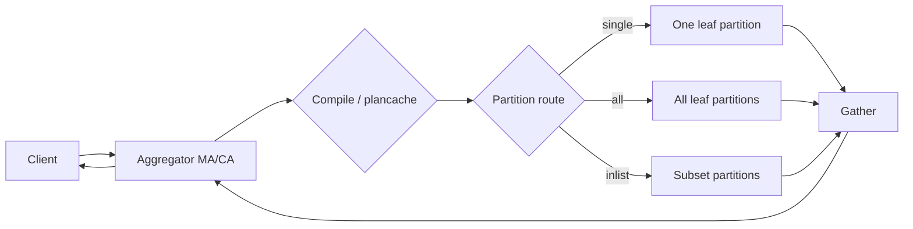

# Query Tracer — Feature Design Document

**Status:** Phase 0 MVP implemented (2026-07-12)
**Author:** S2 Report Sniffer design session  
**Date:** 2026-07-12  
**Grounding:** [SingleStore Self-Managed v9.x docs](https://docs.singlestore.com/db/v9.0/), [Helios docs](https://docs.singlestore.com/cloud/), existing S2RS parsers and UI

---

## 1. Research Summary (Official SingleStore Documentation)

### 1.1 Query lifecycle in a distributed cluster

SingleStore is a **shared-nothing distributed database**. Clients send SQL to an **aggregator** (Master Aggregator or Child Aggregator). Aggregators route work to **leaf** nodes, which store data in **partitions** and perform local compute. Results are aggregated back to the client.

Canonical flow (self-managed and Helios share this model; Helios uses "workspace" instead of "cluster"):

```text
Client
  │  TCP/MySQL protocol, session vars (interpreter_mode, activity_tracking_id, …)
  ▼
Aggregator (MA or CA)
  │  Parse → optimize → compile (first-seen query shape) OR reuse plancache
  │  Partition routing decision (single / inlist / all)
  ▼
Leaf partition(s)
  │  Local scan/join/agg; optional Repartition / Broadcast / Shuffle
  │  Locks acquired on leaves (row/table locks live on data partitions)
  ▼
Aggregator
  │  Gather / GatherMerge intermediate streams
  ▼
Client (result set or error)
```

**Key references:**
- [Cluster Components](https://docs.singlestore.com/db/v9.0/introduction/distributed-architecture/cluster-components/) — MA/CA/LEAF roles
- [Query Execution (Helios)](https://docs.singlestore.com/cloud/getting-started-with-singlestore-helios/about-singlestore-helios/query-execution/) — shard-key routing, distributed joins
- [Code Generation](https://docs.singlestore.com/db/v9.0/query-data/advanced-query-topics/code-generation/) — interpret-first, async compile, per-node plancache
- [Query Plan Operations](https://docs.singlestore.com/db/v9.0/query-data/query-plan-operations/) — Gather, Repartition, Broadcast, MergeJoin, etc.

#### Compilation & distribution

| Stage | Where | What happens |
|-------|-------|--------------|
| **Parse / normalize** | Aggregator | SQL → internal representation; parameterization of literals |
| **Optimize** | Aggregator | Shard-key routing, join strategy (local vs repartition vs broadcast) |
| **Compile** | Aggregator + leaves | LLVM codegen or interpret (`interpreter_mode`); first run incurs compile overhead |
| **Plan cache** | Each node | In-memory + on-disk plancache; `activity_name` stable across plan_id changes |
| **Distribute** | Aggregator → leaves | `Gather` attribute: `partitions:single`, `partitions:inlist`, or `partitions:all` |
| **Execute** | Leaf partitions | TableScan, HashJoin, Repartition, etc. |
| **Aggregate results** | Aggregator | Gather/GatherMerge; return to client |

**Distributed Plan Cache (DPC):** Aggregators and leaves can share compiled plans to skip redundant compilation across the cluster ([Code Generation](https://docs.singlestore.com/db/v9.0/query-data/advanced-query-topics/code-generation/)).

#### Partition routing (inference signal for tracer)

From [Query Execution](https://docs.singlestore.com/cloud/getting-started-with-singlestore-helios/about-singlestore-helios/query-execution/):

- **Single-partition query:** `WHERE` equality on every shard-key column → one partition only (`partitions:single`). Highest concurrency, lowest fan-out.
- **IN-list on shard key:** `partitions:inlist` — only matching partitions contacted.
- **Otherwise:** fan-out to all partitions (`partitions:all`).

Distributed joins without aligned shard keys trigger **Repartition** (hash redistribution) or **Broadcast** (small table copied to all nodes) — expensive, high connection/thread usage ([Shard Keys](https://docs.singlestore.com/db/v9.1/create-a-database/optimizing-table-data-structures/shard-keys/)).

### 1.2 Helios vs self-managed — relevant differences

| Topic | Self-managed | Helios (cloud) |
|-------|--------------|----------------|
| Topology terms | Cluster, nodes, aggregators, leaves | Workspace, same node roles |
| Query execution model | Identical MA/CA/LEAF routing | Identical; docs under "workspace" |
| Visual Explain | Studio / SQL Editor EXPLAIN + PROFILE | Same; Studio recommended for expensive-query investigation |
| Unlimited storage | N/A or deployment-specific | Blob cache fields in `MV_ACTIVITIES`: `BLOB_CACHE_MISS_B`, `BLOB_CACHE_WAIT_TIME_MS` |
| Management views | `information_schema.*` on aggregator | Same views; aggregator-only for `mv_activities`, `mv_queries`, `mv_finished_tasks` |
| Troubleshooting flow | [Investigating expensive queries](https://docs.singlestore.com/db/v9.0/user-and-cluster-administration/troubleshooting/2-investigating-expensive-queries.md) | Parallel Helios docs; Visual Explain in Studio |

**Tracer implication:** UX and data model can be unified. Helios-specific failure hints (blob cache wait) should be surfaced when `MV_ACTIVITIES` columns are present in future bundle collectors.

### 1.3 Observable signals in support bundles & management views

#### Currently collected by `sdb-report` and parsed by S2RS

| Signal | Bundle file | Parsed today | Tracer utility |
|--------|-------------|--------------|----------------|
| Query text ↔ activity mapping | `informationSchemaMvQueries.json` | `queries[]` (≤500 rows) | Identity, pattern match |
| Running queries snapshot | `informationSchemaProcesslist.json` | `cluster_overview.processlist` (≤200) | Stage: executing, elapsed, connection id |
| Cluster-wide processlist | `informationSchemaMvProcesslist.json` | `cluster_overview.mv_processlist` (≤200) | Queued state, cross-node view |
| Blocked / waiting queries | `informationSchemaMvBlockedQueries.json` | `cluster_overview.blocked_queries` (≤2000) | Failure stage: lock/DDL/compile/cluster op |
| Workload management | `showWorkloadManagementStatus.json` | `workload_management[]` | Queued/killed by resource governor |
| Resource pools | `informationSchemaResourcePools.json` | `resource_pools[]` | Pool saturation, OOM-kill context |
| Partition layout | `*distributed_databases.tsv`, MV_NODES | `partitions`, `cluster_layout` | Routing inference (single vs all) |
| Alloc memory by context | `*show-status-extended.tsv` (alloc) | `alloc_memory` | Memory pressure by query context |
| Tracelogs | `memsqlTracelogs/*_memsql.log` | Log search (raw/parsed) | ETIMEDOUT, compile failures, retry stalls |
| Node topology | `informationSchemaMvNodes.json` | `cluster_overview`, topology map | MA/CA/LEAF placement |

#### Documented but NOT parsed today (high value for tracer)

| Signal | Doc reference | Why it matters |
|--------|---------------|----------------|
| `MV_ACTIVITIES` | [Workload profiling](https://docs.singlestore.com/db/v9.0/query-data/query-tuning/workload-profiling/mv-activities/) | Groups per-query tasks across partitions; CPU/mem/network/lock stats |
| `MV_FINISHED_TASKS` | [MV_FINISHED_TASKS](https://docs.singlestore.com/db/v9.0/reference/information-schema-reference/management/mv-finished-tasks/) | Completed-task profiles; better avg latency than MV_ACTIVITIES |
| `MV_PLANCACHE` / `PLANCACHE` | [Code Generation](https://docs.singlestore.com/db/v9.0/query-data/advanced-query-topics/code-generation/) | Plan reuse, execution counts, cumulative stats |
| `EXPLAIN` / `PROFILE` / Visual Explain | [Query plan operations](https://docs.singlestore.com/db/v9.0/query-data/query-plan-operations/) | Authoritative operator tree (Gather, Repartition, TableScan) |
| `activity_tracking_id` | MV_ACTIVITIES docs | Session-level correlation for pipeline/SP queries |
| `MV_WORKLOAD_MANAGEMENT_STATUS` | [Troubleshooting §3](https://docs.singlestore.com/db/v9.1/user-and-cluster-administration/troubleshooting/3-are-any-queries-waiting-on-something.md) | Queue depth |

**Known bundle gap (from prior S2RS analysis):** `informationSchemaMvQueries.json` is often present but may lack `ELAPSED_TIME` — processlist becomes the elapsed-time fallback (`extract_query_patterns` already prefers `queries` then falls back to `processlist`).

**Resolved:** `query_analysis` is populated by `extract_query_analysis()` in `parsers.py` and exposed on `/api/reports/{id}/queries`. Query Tracer workflows use the dedicated `query_traces` API for trace resolution and indexing.

### 1.4 Failure modes (documented → tracer stages)

| Failure mode | Typical stage | Observable in bundle | Doc reference |
|--------------|---------------|----------------------|---------------|
| Lock wait timeout (1205) | Leaf lock acquire | `MV_BLOCKED_QUERIES`, processlist, tracelog | [ERROR 1205](https://docs.singlestore.com/db/v9.1/reference/troubleshooting-reference/query-errors/error-1205-hy-000-lock-wait-timeout-exceeded-try-restarting-transaction/) |
| Blocking: DDL / compile / cluster op | Pre-execute or execute | `blocking_type` in MV_BLOCKED_QUERIES | [MV_BLOCKED_QUERIES](https://docs.singlestore.com/db/v9.1/reference/information-schema-reference/management/mv-blocked-queries/) |
| Runaway / hung query | Execute | processlist `Time`, MV_PROCESSLIST `state=queued` | [Troubleshooting §2–3](https://docs.singlestore.com/db/v9.1/user-and-cluster-administration/troubleshooting/3-are-any-queries-waiting-on-something.md) |
| WLM queue / kill | Pre-execute (aggregator) | `workload_management`, resource pools | Same |
| Compilation timeout / memory | Compile (aggregator) | Tracelog `Failed to finalize asynchronous compilation` | [Query Compilation FAQ](https://docs.singlestore.com/db/v9.1/introduction/faqs/query-compilation/) |
| Network timeout (ETIMEDOUT) | Distribute / execute | Tracelog patterns (already in S2RS) | Superchecker + log search |
| Partition skew / rebalance | Distribute / storage | `explain_rebalance_partitions`, rebalance events | Storage panels |
| Replication async transition | Execute (replica read) | `replication_lag_patterns`, tracelog | ReplicationLagPanel |
| Blob cache stall (Helios) | Execute (leaf) | `BLOB_CACHE_WAIT_TIME_MS` in MV_ACTIVITIES | MV_ACTIVITIES Helios columns |

---

## 2. Problem Statement & User Personas

### Problem

Support engineers investigating SingleStore query incidents must manually correlate disconnected artifacts in an `sdb-report` zip: processlist rows, blocked-query chains, MV_QUERIES text, tracelog errors, partition layout, and workload management — across dozens of nodes. There is no **single visual narrative** answering: *"Where did this query go, and where did it get stuck?"*

### Primary persona: L2/L3 Support Engineer

- Receives offline bundle from customer (air-gapped OK).
- Needs to explain failure to customer in <30 minutes.
- Cares about: lock chains, runaway queries, compile issues, network pressure, wrong shard routing.
- Does **not** have live cluster access during initial triage.

### Secondary persona: Customer SRE / DBA

- Uploads bundle via S2RS desktop or web UI.
- Wants actionable remediation tied to official docs.
- Needs confidence labels when inference is partial.

### Success criteria

1. Select a query (or pattern) from snapshot data and see a **stage diagram** (Client → Aggregator → Leaf → Aggregator → Client).
2. Highlight the **most likely failure stage** with evidence links (blocked row, log line, superchecker finding).
3. Never imply live tracing accuracy from static snapshots — show **confidence tier** on every stage.
4. Work fully offline; optional future phase for live attach.

---

## 3. Data Sources Available Today

### 3.1 Backend (`backend/parsers.py`)

| Extractor | Output key | Endpoint(s) | Tracer use |
|-----------|------------|-------------|------------|
| `extract_query_patterns()` | `query_patterns` | `/overview` | Query picker: slow/runaway/repeated/high-memory |
| `extract_long_running_transactions()` | `long_running_transactions` | `/overview` | Lock/tx failure stage |
| `extract_process_health()` | `process_health` | internal | Active vs sleeping-open-tx |
| Centralized `mv_queries` | `queries[]` | `/queries` | Activity name, query text |
| `blocked_queries` | `cluster_overview.blocked_queries` | `/queries`, `/overview` | Blocking graph |
| `processlist` / `mv_processlist` | `cluster_overview.*` | `/queries` | Connection id, elapsed, node |
| `build_alloc_memory_overview()` | `alloc_memory` | `/queries` | Memory by alloc context |
| `build_cluster_overview()` | `cluster_overview` | `/overview` | Node roles, online/offline |
| Partition / layout parsers | `partitions`, `cluster_layout` | `/overview`, `/nodes` | Fan-out inference |
| Log pattern extractors | `log_patterns`, raw log search | `/logs/search` | ETIMEDOUT, compile, fsync |
| `extract_replication_lag_patterns()` | `replication_lag_patterns` | `/overview` | Replica-read failures |

### 3.2 API surface today

```
GET /api/reports/{id}/overview     → query_patterns, long_running_transactions, cluster_layout, …
GET /api/reports/{id}/queries      → queries, processlist, blocked_queries, workload_management, alloc_memory, query_analysis
GET /api/reports/{id}/logs/search  → raw tracelog context windows
GET /api/reports/{id}/triage       → prioritized findings (correlate by category)
```

### 3.3 Frontend components today

| Component | Location | Overlap with tracer |
|-----------|----------|---------------------|
| `WorkloadQueries.jsx` | Queries tab | Tables, heatmap, blocked/processlist/WLM tabs — **launch pad for tracer** |
| `QueryPatternsPanel.tsx` | Overview tab | Slow/runaway/repeated — **query picker candidates** |
| `LongRunningTransactionsPanel.tsx` | Overview tab | Lock contention summary |
| `ClusterTopologyMap.tsx` | Overview tab | D3 force graph — **reuse interaction patterns** (zoom, select, tooltips) |
| `ReplicationLagPanel` | Overview | Adjacent failure context |

---

## 4. Gaps vs Ideal Tracer

### 4.1 What bundles do NOT capture (honest limits)

| Ideal signal | Gap | Mitigation in S2RS |
|--------------|-----|-------------------|
| Per-query EXPLAIN/PROFILE operator tree | Not in standard `sdb-report` | Request optional `explain_<hash>.json` collector; MVP shows **inferred** routing from SQL + schema |
| Sub-second stage timestamps | Snapshot views are point-in-time | Show durations only when present; label "snapshot delta unknown" |
| Cross-stage causality chain for one connection | processlist id may not join to MV_QUERIES activity_name | Correlate by normalized SQL + time window + node_id heuristics |
| Per-partition leaf execution detail | No per-partition processlist in bundle | Infer fan-out from partition count + shard-key hints |
| Failed query error text | May be only in tracelog, not structured | Log search correlation pass |
| MV_ACTIVITIES / MV_FINISHED_TASKS | Not parsed | Phase 2 parser extension + collector verification |

### 4.2 Architectural gaps in S2RS

1. **`query_analysis` wired** — `extract_query_analysis()` populates the field; tracer index uses `query_traces` API.
2. **No query identity model** — need stable `trace_id` = hash(normalized_sql, activity_name?, connection_id?, node_id?).
3. **No cross-artifact join layer** — tracer needs `build_query_trace(query_selector) -> trace_graph`.
4. **No dedicated API route** — tracer payload should not bloat `/overview` for every report load.

---

## 5. Proposed UX

### 5.1 Entry points

1. **Workload & Queries tab** → "Trace this query" action on processlist / queries table rows.
2. **Query Patterns panel** → "Trace pattern" on runaway/slow entries.
3. **Long-Running Transactions / Blocked tab** → "Trace blocked query" pre-selects blocker + blocked pair.
4. **Triage / Recommendations** → deep-link when finding category is `queries` or `locks`.

### 5.2 Query Tracer view (new sub-route or drawer)

`ReportDashboard` → `/report/:id/queries/trace/:traceId` (or full-page panel)

```
┌─────────────────────────────────────────────────────────────────────────┐
│ Query Tracer — SELECT * FROM orders WHERE status = 'pending'  [⚠ 62%]  │
├─────────────────────────────────────────────────────────────────────────┤
│ [Summary] [Flow] [Timeline] [Logs] [Related Findings]                    │
├─────────────────────────────────────────────────────────────────────────┤
│  FLOW (horizontal DAG, DESIGN.md dark theme)                             │
│                                                                          │
│   ┌────────┐    ┌─────────────┐    ┌──────────────┐    ┌────────┐     │
│   │ Client │───▶│ Aggregator  │───▶│ Leaf (×N)    │───▶│ Agg    │──▶ Out│
│   │        │    │ MA 10.0.0.1 │    │ fan-out: all │    │ Gather │     │
│   └────────┘    │ COMPILE?    │    │ ⚠ LOCK WAIT  │    └────────┘     │
│                 └─────────────┘    └──────────────┘                      │
│                        │                  ▲                              │
│                        └──── WLM queue ────┘ (if queued)                 │
├─────────────────────────────────────────────────────────────────────────┤
│ Evidence strip: MV_BLOCKED_QUERIES row #42 · processlist id 17 · 3 logs │
└─────────────────────────────────────────────────────────────────────────┘
```

#### Flow diagram nodes (stages)

| Stage ID | Label | Role | Status coloring |
|----------|-------|------|-----------------|
| `client` | Client | External | Neutral |
| `aggregator_ingress` | Aggregator receive | MA/CA | Warning if WLM queued |
| `compile` | Plan compile | MA (primarily) | Warning if compile lock / log compile fail |
| `route` | Partition routing | MA | Info: single / inlist / all (inferred) |
| `leaf_execute` | Leaf execution | LEAF × N | Critical if blocked, ETIMEDOUT, OOM |
| `leaf_lock` | Lock acquire | LEAF | Critical if `blocking_type` = row/table lock |
| `distribute` | Repartition/Broadcast | LEAF network | Warning if skew / rebalance active |
| `aggregator_gather` | Gather results | MA/CA | Warning if high elapsed, memory |
| `client_return` | Result / error | External | Critical on failure |

**Visual language:** Reuse `ClusterTopologyMap.tsx` patterns — SVG + D3 `zoom`, role colors (MA red tint, leaf green, aggregator blue), accent `#00d992` for healthy path, semantic reds/ambers for failure. **Solid border** = observed evidence; **dashed border** = inferred.

#### Timeline tab

Horizontal swim-lane chart (one lane per node role):

- **Observed events:** processlist snapshot time, blocked-query detection, log line timestamps (if tracelog timeframe known from `first_log_entry`/`last_log_entry`).
- **Inferred phases:** compile window (if compile lock), fan-out (from partition count).
- Show **snapshot timestamp** from bundle metadata when available (`memsqlctlInfo.json`, report collection time).

#### Correlated logs tab

Embed filtered log search results for correlated patterns:

- Query text substring (truncated)
- Connection id / node hostname
- Known diagnostic patterns: `ETIMEDOUT`, `lock wait`, `compilation`, `Retry loop is stalling`

### 5.3 Confidence & accuracy UX

Every tracer view displays a **Trace Confidence Score** (0–100) with breakdown:

| Factor | Weight | Source |
|--------|--------|--------|
| Exact connection id match | +25 | processlist ↔ blocked_queries |
| activity_name in MV_QUERIES | +20 | queries[] |
| Blocked-query row present | +20 | MV_BLOCKED_QUERIES |
| Tracelog correlation | +15 | log search hits |
| EXPLAIN/PROFILE available | +20 | future collector |
| Fan-out inference only | −15 | no shard-key metadata |

Badge tiers: **High (≥80)**, **Medium (50–79)**, **Low (<50)** — always visible in header.

Copy for low confidence: *"This trace is reconstructed from a point-in-time bundle, not live query profiling. Stages marked dashed are inferred."*

---

## 6. Technical Architecture

### 6.1 New parser module: `extract_query_trace()`

Location: `backend/parsers.py` (or `backend/query_tracer.py` if file grows).

```python
def build_query_trace_index(report: dict) -> dict:
    """Build index of traceable queries from all sources."""

def extract_query_trace(report: dict, selector: dict) -> dict:
    """
    selector: { normalized_sql?, activity_name?, connection_id?, query_text? }
    Returns trace graph + evidence + confidence.
    """
```

**Output shape (proposed):**

```json
{
  "trace_id": "sha256:…",
  "selector": { "activity_name": "Select_orders_abc123", "connection_id": 42 },
  "query_text": "SELECT * FROM orders WHERE status = ?",
  "confidence": { "score": 62, "tier": "medium", "factors": [...] },
  "stages": [
    {
      "id": "aggregator_ingress",
      "node_role": "MA",
      "node_host": "10.0.0.1",
      "status": "warning",
      "observed": true,
      "metrics": { "elapsed_sec": 45.2, "state": "executing" },
      "evidence": [{ "source": "processlist", "row_ref": 3 }]
    }
  ],
  "edges": [
    { "from": "client", "to": "aggregator_ingress", "label": "connect" },
    { "from": "aggregator_ingress", "to": "leaf_execute", "label": "partitions:all", "inferred": true }
  ],
  "failure": {
    "stage_id": "leaf_lock",
    "category": "lock_wait",
    "summary": "Blocked by open idle transaction on node 3",
    "blocking_type": "user transaction row lock"
  },
  "related_findings": ["longRunningTransactions", "lockContention"],
  "log_correlations": [
    { "node": "leaf-3", "pattern": "lock wait timeout", "line_number": 882341 }
  ]
}
```

#### Correlation algorithm (MVP)

1. **Normalize** selector SQL via existing `_normalize_sql()`.
2. **Gather candidates** from `queries[]`, `processlist`, `blocked_queries`, `query_patterns.*`.
3. **Score matches** on normalized SQL equality; boost on `connection_id` / `activity_name`.
4. **Build stage list** using deterministic rules (see §1.1 lifecycle).
5. **Attach evidence** pointers (row indices, not full row duplication).
6. **Run log search** optionally (bounded: 20 hits) for correlated patterns.
7. **Join superchecker** findings by category overlap.

#### Partition routing inference (no EXPLAIN)

Heuristic only — mark `inferred: true`:

- Parse `FROM` / `WHERE` tables from query text (lossy).
- Cross-reference `partitions` / `distributed_databases` shard-key metadata if present in bundle TSVs.
- Default to `partitions:all` when uncertain.
- If `WHERE` contains equality literals on known shard-key columns → upgrade to `partitions:single` with medium confidence.

### 6.2 API

```
GET /api/reports/{id}/query-traces
  → list traceable queries (index: trace_id, summary, confidence, failure_stage)

GET /api/reports/{id}/query-traces/{trace_id}
  → full trace payload

POST /api/reports/{id}/query-traces/resolve
  body: { query_text?, connection_id?, activity_name? }
  → compute trace on demand (for ad-hoc selection)
```

Add helpers to `frontend/src/lib/api.js`: `listQueryTraces`, `getQueryTrace`, `resolveQueryTrace`.

Validators: extend `validators.py` with `validate_trace_id()`, `validate_query_trace_selector()`.

### 6.3 Frontend components

| Component | File | Notes |
|-----------|------|-------|
| `QueryTracerPage.tsx` | pages or components | Container, tabs, confidence header |
| `QueryTraceFlowDiagram.tsx` | components | SVG DAG via `computeDAGLayout` pattern or D3 (like ClusterTopologyMap) |
| `QueryTraceTimeline.tsx` | components | Swim-lane timeline |
| `QueryTraceEvidencePanel.tsx` | components | Source tables with deep links |
| `QueryTracePicker.tsx` | components | Modal/sidebar from WorkloadQueries |

**Integration points:**

- `WorkloadQueries.jsx` — add Trace button → `resolveQueryTrace` → navigate.
- `QueryPatternsPanel.tsx` — add link per runaway/slow row.
- `ReportDashboard.jsx` — optional route `queries/trace/:traceId`.

### 6.4 Superchecker integration

Add optional check (Phase 2): `queryTraceAvailable` (info) when high-confidence traces exist with failures — links to tracer from Recommendations.

Do **not** rename existing check IDs.

---

## 7. Phased Roadmap

### Phase 0 — Foundation (1 sprint)

- [x] Implement `build_query_trace_index()` + `extract_query_trace()` MVP (`backend/query_tracer.py`)
- [x] Dedicated `query_traces` API (replaces empty `query_analysis` stub for tracer workflows)
- [x] `GET /query-traces` + `POST /resolve` endpoints
- [x] `QueryTracerPanel` with flow diagram (observed + inferred stages)
- [x] Tests: `test_query_tracer.py` with synthetic processlist + blocked_queries fixtures

**MVP scope:** Lock-wait and runaway-query traces with high confidence when `MV_BLOCKED_QUERIES` + processlist align.

### Phase 1 — Inference layer (1–2 sprints)

- [x] Partition routing inference (`partitions:single|inlist|all`)
- [x] Dashed inferred nodes (compile, distribute, gather)
- [x] Log correlation pass (bounded raw search when extracted root persisted)
- [x] Timeline swim-lanes (`QueryTraceTimeline.tsx`)
- [x] Deep links from triage / superchecker findings (`Recommendations.jsx`)

### Phase 2 — Richer signals (2+ sprints)

- [ ] Parse `MV_ACTIVITIES` / `MV_FINISHED_TASKS` if added to bundle collector
- [ ] Parse `MV_PLANCACHE` for execution counts / plan reuse indicator
- [ ] Optional `explain_*.json` / PROFILE JSON attachment per traced query
- [ ] Operator-level diagram (TableScan, Repartition) when EXPLAIN JSON present
- [ ] Helios blob-cache wait stage

### Phase 3 — Live attach (future, explicit non-goal for local-first MVP)

- [ ] Optional connector to running cluster (user-initiated, not default)
- [ ] `PROFILE` + `SHOW PROFILE JSON` on demand
- [ ] Real-time MV_ACTIVITIES polling — **out of scope for air-gapped mission**

### Collector recommendations for SingleStore bundle team

Request these additions to `sdb-report` for tracer accuracy:

1. `informationSchemaMvActivities.json` (aggregator snapshot)
2. `informationSchemaMvFinishedTasks.json` (last N minutes)
3. `informationSchemaMvPlancache.json` (top K by elapsed)
4. Per-incident: `EXPLAIN` + `PROFILE` JSON for top N expensive queries
5. Bundle-level **collection timestamp** ISO-8601 in manifest

---

## 8. Accuracy Constraints

### 8.1 Snapshot vs live tracing

| Aspect | Static bundle (S2RS) | Live PROFILE |
|--------|----------------------|--------------|
| Stage timing | Point-in-time; may mismatch across views | Sub-operator timing |
| Failure location | Often inferable for locks/queues | Definitive |
| Partition fan-out | Heuristic | `partitions:*` on Gather operator |
| Compile stall | Log patterns only | `compile_time_stats` in PROFILE JSON |

**Rule:** Never label inferred stages as "failed" without observed evidence. Use "suspected bottleneck" language.

### 8.2 Confidence levels (user-facing)

| Tier | Meaning | Typical scenario |
|------|---------|------------------|
| **High** | Multiple independent sources agree | Blocked query + processlist id + matching SQL |
| **Medium** | SQL match + partial node context | Runaway in processlist, no blocked row |
| **Low** | Pattern-only from MV_QUERIES text | No connection id, no elapsed time |

### 8.3 Known false-positive risks

- **Repeated query shapes** — MV_QUERIES is de-parameterized; multiple concurrent instances collapse.
- **Artificial internal queries** — MV_QUERIES includes node-to-node queries; filter `activity_type` when available.
- **Clock skew** — log timestamps vs processlist snapshot may not align.
- **Centralized vs per-node duplication** — prefer centralized cluster_overview when authoritative (same pattern as rebalance_status).

---

## 9. Top 5 Design Decisions

1. **Offline-first correlation engine** — Tracer is a deterministic join over existing bundle artifacts, not a live profiler. Live attach is Phase 3 only.

2. **Observed vs inferred visual layers** — Solid nodes have evidentiary rows; dashed nodes use routing/heuristic rules. Prevents false precision.

3. **`trace_id` + resolve API** — Ad-hoc tracing via `POST /resolve` avoids precomputing traces for all 500 MV_QUERIES rows on every upload.

4. **Reuse ClusterTopologyMap interaction model** — D3/SVG zoom, role-colored nodes, click-for-evidence panel — consistent with DESIGN.md dark theme.

5. **Confidence score is mandatory UI chrome** — Every trace displays tier + factor breakdown; low-confidence traces still useful but clearly labeled.

---

## 10. Three Highest-Risk Accuracy Gaps

1. **No EXPLAIN/PROFILE in bundles** — Without operator trees, partition fan-out and distribute/repartition stages are heuristic. Mis-routing inference is likely for complex joins.

2. **Temporal misalignment across snapshots** — `processlist`, `MV_BLOCKED_QUERIES`, and `MV_QUERIES` may reflect different microseconds during collection; joining on connection id can fail silently.

3. **MV_ACTIVITIES / per-partition task stats absent** — Official docs state MV_ACTIVITIES groups tasks across partitions ([source](https://docs.singlestore.com/db/v9.0/query-data/query-tuning/workload-profiling/mv-activities/)); without it, leaf-stage timing and network/lock metrics cannot be authoritative.

---

## 11. References

- [Cluster Components](https://docs.singlestore.com/db/v9.0/introduction/distributed-architecture/cluster-components/)
- [Code Generation](https://docs.singlestore.com/db/v9.0/query-data/advanced-query-topics/code-generation/)
- [Query Plan Operations](https://docs.singlestore.com/db/v9.0/query-data/query-plan-operations/)
- [MV_ACTIVITIES](https://docs.singlestore.com/db/v9.0/query-data/query-tuning/workload-profiling/mv-activities/)
- [MV_QUERIES](https://docs.singlestore.com/db/v9.0/reference/information-schema-reference/management/mv-queries/)
- [MV_FINISHED_TASKS](https://docs.singlestore.com/db/v9.0/reference/information-schema-reference/management/mv-finished-tasks/)
- [MV_BLOCKED_QUERIES](https://docs.singlestore.com/db/v9.1/reference/information-schema-reference/management/mv-blocked-queries/)
- [Investigating expensive queries](https://docs.singlestore.com/db/v9.0/user-and-cluster-administration/troubleshooting/2-investigating-expensive-queries.md)
- [Are queries waiting on something?](https://docs.singlestore.com/db/v9.1/user-and-cluster-administration/troubleshooting/3-are-any-queries-waiting-on-something.md)
- S2RS: `backend/parsers.py`, `frontend/src/components/WorkloadQueries.jsx`, `ClusterTopologyMap.tsx`, `DESIGN.md`

---

## Appendix A — Mermaid reference flow



---

*End of document.*
