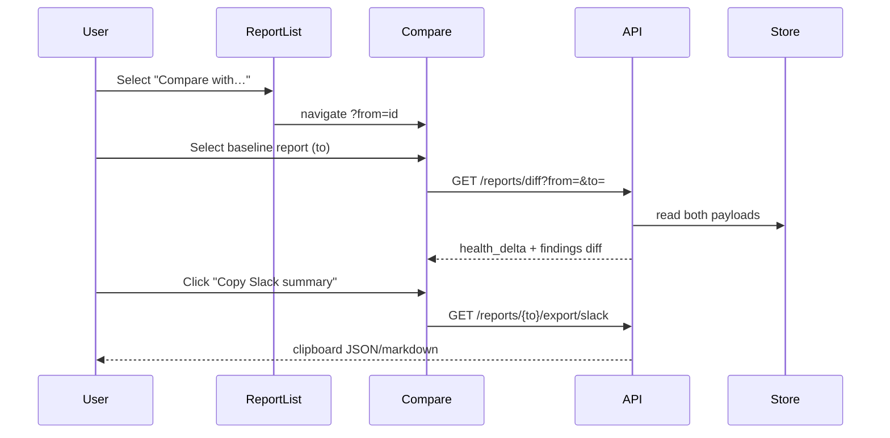

# Unified Sprint Design — Triage, Diagnostics & Desktop

**Date:** 2026-07-03  
**Status:** Draft — awaiting review  
**Tracks:** (1) Field engineer triage, (2) Deep diagnostics, (3) Desktop / airgap rollout  
**Prerequisite:** Merge open PR #68 and commit uncommitted Phase 5 diagnostic work on branch `feat/topology-incident-clusters-desktop-packaging`.

---

## Problem statement

S2 Report Sniffer has strong parsing and scoring, but three gaps block daily field-engineer use and customer rollout:

| Gap | Current state | User pain |
|-----|---------------|-----------|
| **Compare** | `GET /api/reports/diff` exists; no UI | Cannot answer “did we get better after the fix?” |
| **Share** | `/export/slack` + `/export/html` exist; triage copy is client-only in Recommendations | Hard to paste a consistent exec summary into Slack/email |
| **Replication view** | Signals scattered (`replication_status`, `pressure_events_per_hour.async_transition`) | Engineers hunt across tabs during lag incidents |
| **Desktop confidence** | Build scripts exist; no CI smoke or documented unsigned path | Airgap customers cannot trust installers |

This spec defines a **sequenced multi-track sprint** that delivers all three personas without a single mega-PR.

---

## Goals & non-goals

### Goals

1. **Triage loop (Track 1):** Select two reports → see finding diff + health delta → export share pack in &lt;60 seconds.
2. **Diagnostics (Track 2):** One Replication Health panel + honest memory utilization (snapshot now, trend when data exists).
3. **Distribution (Track 3):** Unsigned desktop build in CI + local smoke script aligned with `AIRGAP_TEST_PROTOCOL.md`.

### Non-goals (this sprint)

- Signed/notarized macOS + Windows code signing pipeline (Phase 4.1 follow-up).
- Auto-update via electron-updater (deferred).
- Deferred superchecker tickets SUP-101–104 (NUMA/SSD/NLP mining).
- Glean enrichment (airgap-sensitive; separate spec).
- PDF export (HTML export + browser print is sufficient for v1).

---

## Sequencing approaches considered

### A — Strict waterfall (recommended)

| Milestone | Duration | Deliverable |
|-----------|----------|-------------|
| **M0 Foundation** | 1–2 days | Merge PR #68, commit Phase 5, refresh AGENTS.md |
| **M1 Triage loop** | 4–6 days | Compare UI + Share pack |
| **M2 Diagnostics** | 4–5 days | Replication panel + memory trend v1 |
| **M3 Desktop** | 3–4 days | CI unsigned build + smoke script |

**Why:** Each milestone is independently shippable; desktop benefits from stable UI/API from M1–M2.

### B — Parallel workstreams

Three owners on compare, replication, desktop simultaneously.

**Risk:** API shape churn (extended diff) breaks in-flight UI; avoid unless team ≥2.

### C — Desktop-first

Ship installers before compare UI.

**Risk:** Installs bundle incomplete UX; field engineers still blocked on daily workflow.

**Decision:** **Approach A (milestone waterfall).**

---

## Architecture overview

```mermaid
flowchart TB
  subgraph M0 [M0 Foundation]
    PR68[Merge PR #68]
    P5[Commit Phase 5 diagnostics]
  end

  subgraph M1 [M1 Triage Loop]
    CompareUI[ReportCompare page]
    DiffAPI[Extended /reports/diff]
    Share[SharePack actions]
  end

  subgraph M2 [M2 Diagnostics]
    ReplPanel[ReplicationHealthPanel]
    MemTrend[Memory trend extractor]
  end

  subgraph M3 [M3 Desktop]
    BuildCI[GH Actions unsigned build]
    Smoke[scripts/smoke-desktop.sh]
  end

  PR68 --> CompareUI
  P5 --> ReplPanel
  CompareUI --> DiffAPI
  Share --> TriageAPI[/reports/id/triage]
  ReplPanel --> Overview[/reports/id/overview]
  BuildCI --> Smoke
```

---

## M0 — Foundation (prerequisite)

### Scope

1. Commit Phase 5 backend + frontend (memory snapshot, query patterns, async pressure, tests).
2. Merge PR #68 to `main`.
3. Update `AGENTS.md`:
   - Move implemented checks from “High-value checks to implement next” to “Implemented”.
   - Distinguish **memory utilization snapshot** vs **trend over time** (trend = M2).
4. Cut branch `feat/triage-compare-share` from updated `main`.

### Acceptance

- `pytest backend/test_*.py` and `npm test && npm run build` green on `main`.
- No `.cursor/` files in commits.

---

## M1 — Field engineer triage loop (Track 1)

### 1.1 Extended report diff API

**Current:** `compute_diff(old_recs, new_recs)` → `{new, resolved, worsened, improved}` (findings only).

**Extend** `GET /api/reports/diff?from_id=&to_id=` response:

```json
{
  "from": { "report_id", "report_name", "uploaded_at", "health_score", "cluster_risk_score" },
  "to":   { "report_id", "report_name", "uploaded_at", "health_score", "cluster_risk_score" },
  "health_delta": { "health_score": -12, "cluster_risk_score": +8 },
  "findings": { "new", "resolved", "worsened", "improved" },
  "metrics": {
    "pressure_events": { "etimedout": { "from_total", "to_total", "delta" } },
    "hot_nodes": { "from_count", "to_count", "delta" }
  }
}
```

**Implementation notes:**

- Add `compute_report_diff(from_payload, to_payload)` in `superchecker.py` wrapping existing `compute_diff`.
- Metric deltas are best-effort; omit keys when payload fields missing (older reports).
- Keep backward compatibility: existing `findings` keys remain at top level OR nested under `findings` — **pick nested** and update `test_api_smoke.py` + `test_server_endpoints.py` once.

### 1.2 Report Compare UI

**Route:** `/compare?from=<uuid>&to=<uuid>` (new top-level route in `App.js`, linked from Report List).

**Components:**

| Component | Responsibility |
|-----------|----------------|
| `ReportCompare.jsx` | Two report selectors (dropdown from `listReports`), diff summary cards, findings tables |
| `CompareSummaryCards` | Health score before/after, delta badge, counts (new/resolved/worsened/improved) |
| `CompareFindingsTable` | Tabbed or stacked lists per diff category; link to finding detail in report |

**UX (DESIGN.md aligned):**

- Purple accent for primary actions; severity colors for finding rows.
- Empty state: “Select a baseline and follow-up report.”
- Pre-fill: from Report List row action “Compare…” opens with `from` set.

**API client:** `getReportDiff(fromId, toId)` in `frontend/src/lib/api.js`.

### 1.3 Share pack

**Goal:** One-click export for incident comms.

**Actions on Recommendations + Compare pages:**

| Action | Mechanism |
|--------|-----------|
| **Copy Slack summary** | Fetch `/export/slack` OR build from triage buckets client-side (prefer API for consistency) |
| **Download HTML** | `window.open(/api/reports/{id}/export/html)` |
| **Copy triage digest** | Format `act_now` + top incident cluster from `/triage` (extend existing per-finding copy in `Recommendations.jsx`) |

**Security:** Escape HTML in `/export/html` (fix AUDIT_REPORT.md XSS note) using `html.escape` on all interpolated fields.

**New optional endpoint (v1.1 if needed):** `GET /reports/{id}/export/triage-markdown` — plain-text exec summary. **Defer** if Slack + HTML sufficient.

### M1 tests

- Backend: diff extended shape, metric delta with fixture payloads.
- Frontend: vitest smoke for `ReportCompare` selector + empty state.
- Manual: compare two reports from same cluster at different times.

---

## M2 — Deep diagnostics (Track 2)

### 2.1 Replication Health panel

**Location:** New section in `ChartsDashboard.jsx` or dedicated tab under Diagnostics.

**Data sources (already in overview payload):**

- `replication_status[]` — per-database pair state
- `pressure_events_per_hour.async_transition` — hourly log counts
- Finding cross-links: `asyncReplicationTransitions`, `pressureEvents_async_transition`

**UI:**

| Element | Content |
|---------|---------|
| Summary KPIs | # databases async, max hourly async transitions, worst pair |
| Timeline chart | Reuse `PressureEventsChart` filtered to `async_transition` |
| Table | Database, master/partner, state, lag hints from replication_status columns |

**Superchecker:** No new checkers required for v1; panel aggregates existing signals.

### 2.2 Memory utilization — snapshot vs trend

**Already shipped (Phase 5):** `memory_utilization` snapshot + `MemoryUtilizationChart` bar chart.

**Trend v1 (this sprint, scoped):**

Parser: `extract_memory_utilization_trend(nodes)` in `parsers.py`:

1. Scan each node for **multiple** `top`/`free` collector snapshots (timestamped subdirs or rotated files if present in bundle).
2. If &lt;2 samples per node → return `{ "available": false, "reason": "single snapshot" }`.
3. If ≥2 → emit `{ "available": true, "per_node": [{ hostname, series: [{ts, os_used_pct}] }] }`.

Superchecker: only flag **rising** trend (&gt;10pt increase across span) when `available: true`.

UI: sparkline per hot node in `MemoryUtilizationChart` when series exists; otherwise keep current bars + tooltip “Trend requires multi-sample bundle.”

**Acceptance:** Unit tests with synthetic multi-sample fixture; graceful degradation on single-sample bundles (majority of current bundles).

### M2 tests

- Parser trend extraction with 0/1/3 sample fixtures.
- Superchecker trend rule does not fire on snapshot-only data.
- Frontend renders fallback message when `available: false`.

---

## M3 — Desktop / airgap rollout (Track 3)

### 3.1 Local smoke script

**New:** `scripts/smoke-desktop.sh`

1. Run `scripts/build-desktop.sh` (unsigned).
2. Launch backend binary + verify `GET /api/health`.
3. Confirm `frontend/build` served at `/ui/`.
4. Optional: upload tiny test fixture if present in repo.

Exit non-zero on any failure; suitable for developer pre-release check.

### 3.2 CI unsigned desktop build

**New workflow:** `.github/workflows/desktop-build.yml`

- Triggers: `workflow_dispatch`, push to `main` with path filter `desktop/**`, `s2rs-backend.spec`, `scripts/build-desktop.sh`.
- Matrix: `ubuntu-latest`, `macos-latest` (Windows optional v1).
- Steps: checkout → setup Python/Node → `build-desktop.sh` → upload artifacts (`dist/*.dmg`, `dist/*.AppImage`, etc.).
- **No signing secrets** in v1; artifact name includes `unsigned`.

### 3.3 AIRGAP protocol alignment

Update `AIRGAP_TEST_PROTOCOL.md` checklist to include:

- Compare two locally stored reports (M1).
- Replication panel loads offline (M2).
- Desktop smoke script reference.

**Out of scope:** `File → Install Update Package` until electron-updater spec exists.

### M3 tests

- CI job green on `main`.
- Document expected artifact sizes and platform notes in `PACKAGING.md`.

---

## Data flow — Compare + Share



---

## Error handling

| Scenario | Behavior |
|----------|----------|
| Missing report in diff | 404 with clear message |
| Old report lacks triage metadata | Compare still works; Share pack falls back to top findings by risk_score |
| Diff same report | 400 “from_id and to_id must differ” |
| Desktop build fails in CI | Upload logs artifact; do not fail unrelated CI |
| Memory trend unavailable | UI badge + info severity only when rising trend detected with data |

---

## File touch list (estimated)

### M1
- `backend/superchecker.py` — `compute_report_diff`
- `backend/server.py` — extend diff endpoint, HTML escape
- `backend/test_server_endpoints.py`, `backend/test_parsers.py`
- `frontend/src/pages/ReportCompare.jsx` (new)
- `frontend/src/pages/ReportList.jsx` — compare action
- `frontend/src/lib/api.js`
- `frontend/src/App.js` — route

### M2
- `backend/parsers.py` — trend extractor
- `backend/superchecker.py` — trend checker
- `frontend/src/components/charts/MemoryUtilizationChart.jsx`
- `frontend/src/components/charts/ReplicationHealthPanel.jsx` (new)
- `frontend/src/components/ChartsDashboard.jsx`

### M3
- `scripts/smoke-desktop.sh` (new)
- `.github/workflows/desktop-build.yml` (new)
- `PACKAGING.md`, `AIRGAP_TEST_PROTOCOL.md`

---

## Success criteria (sprint complete)

1. Field engineer can compare two reports and copy a Slack-ready summary without opening devtools.
2. Replication incident visible in one Diagnostics panel without reading raw logs.
3. Memory trend shows when data exists; snapshot-only bundles show explicit limitation.
4. CI produces unsigned desktop artifacts; `smoke-desktop.sh` documented in PACKAGING.md.
5. All existing tests pass; new tests cover diff extension, HTML escape, trend graceful fallback.

---

## Open questions (resolved in this spec)

| Question | Decision |
|----------|----------|
| PDF export? | Defer; HTML + print |
| Diff API breaking change? | Nest findings under `findings` key; update tests |
| Memory trend without multi-sample bundles? | Snapshot only + honest UI message |
| Signing in CI? | Deferred to post-sprint |

---

## Implementation plan next step

After approval of this spec, invoke **writing-plans** skill to produce:

- `docs/superpowers/plans/2026-07-03-unified-sprint-implementation.md`
- Task breakdown per milestone with exact test commands and PR slicing (M1/M2/M3 as separate PRs off `main`).
